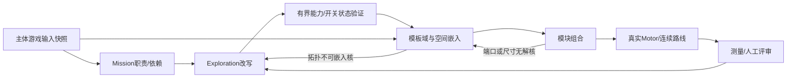

# 统一 Map 设计接口与演进架构

状态：`proposed / research`，任务 MAPGEN-RESEARCH-01。管理仓库为 map-edit；主体游戏是能力、物理、内容和操作证据的权威输入。本文不宣布新算法已达到正式准入，也不开放新地区或能力。

## 推荐架构

以 **Mission/Exploration Graph Grammar + 内容感知的有界约束嵌入** 为共同骨架；Runtime优先小预算回溯、缓存兼容域与已验候选库，ASP作为离线约束参考与反例工具；进化/MAP-Elites在离线保留不同探索风格。三者通过同一数据接口替换策略，避免为每条算法重建一套装配、保存或编辑器。

这不是根据论文名次定结论：A实现简单且可限制延迟；B对依赖约束表达强但部署、grounding和尾延迟要实测；C适合保留多种好解，在线无界搜索风险高。最终选择须看同内容真实模块集和真实Motor结果。本轮抽象实验只是筛掉错误路线，不能决定玩家认可。

推荐反馈关系：



让模板候选域、占用形状与入口出口状态在嵌入前参与决策。局部地形BSP/CA/WFC只能在已分配空间与保护的路线/净空内工作；新地形改变碰撞承诺时，必须失效之前的物理证据并重新验证。

2026-10-24 方向修订：不先铺一条固定横向入口→Boss 链，再向外添加奖励。将首访多路线、地标间汇合、深处奖励的异处回归与状态化捷径作为区域职责；主线短约束完成成本，不约束横向直达。局部咽喉和 Boss 门可以保留，不要求全图处处双连通。独立 R2 用双连通核心检验这个方向，尚未完成任务引导的语法或真实内容嵌入，见 [修订及证据](region-exploration-revision.md)。

## 契约的所有权

| 数据 | 权威与管理位置 | 允许消费的结论 |
|---|---|---|
| 核心动作、资源、装备、授予点 | 游戏config/Definition/PlayerMotor，固定commit导入 | 已实现与实际授予分开；H/W/D不能按目录存在推断 |
| Cell/Module几何与操作 | 游戏Definition/factory + Map Notes源快照 | 原几何/参数；编辑草图不是碰撞和通过证据 |
| Macro模板与transfer evidence | map-edit关卡资产，引用固定游戏输入/物理回执 | 只在其能力、端口状态、相位、变换与版本范围内可组合 |
| Map设计/算法/区域策略 | map-edit版本化设计与实验 | 任务意图、图、空间求解状态与诊断 |
| Runtime RunManifest与state/save | 游戏原有消费者 | 游戏adapter生成既有Manifest，不复制一套Run/save生命周期 |
| 真实试玩与质量评价 | 原始轨迹/媒体/回执 + 玩家评审 | 技术、观察、玩家、设备四种来源分别记录 |

复用现有 `tools/level_design_contracts.py` 的 `level_design_intent` 字段与能力状态模型，扩展可执行artifact需要的端口/占用与验证证据，不把intent JSON改名后当Runtime Manifest。复用 Map Notes `capabilityRequirements` 的 `allOf + anyOfGroups`：组内OR、组间AND；`status=partial/unspecified` 只能已知拒绝或unknown，不能自动升级true。`difficulty.scale`与version沿用已有协议，但未知score仍为null。

## MapDesign / MapArtifact 建议接口

这是要落实的契约，不声称以下字段都已有消费者。原型字段到本契约的差异必须由adapter显式报告。

```json
{
  "schema": "map-notes/map-design/v1",
  "artifact_kind": "map_design_intent",
  "id": "windchime/compact-main/deep-reward",
  "inputs": {
    "game_commit": "<40 hex>",
    "notes_commit": "<40 hex>",
    "content_catalog_sha256": "<64 hex>",
    "ability_snapshot_ref": "<actual grant/config evidence>",
    "physics_version_ref": "<engine + motor + tuning + definition hashes>"
  },
  "region_policy": "windchime-open-weave/v1",
  "seed": "experiment/0000",
  "generator": {"id": "grammar-backtracking", "version": 1, "budget_ref": "budget-v1"},
  "mission": {"entry": "spawn", "goal": "boss", "objectives": [], "dependencies": []},
  "exploration": {"nodes": [], "directed_edges": [], "sightlines": []},
  "embedding": {"placements": [], "connections": [], "failures": []},
  "verification": {"logic": "unverified", "geometry": "unverified", "physics": "unverified", "human": "unverified"}
}
```

- Mission node记录职责（观察/教学/恢复/奖励/授予/锁/Boss/地标）、是否强制、前置目标、风险与预算引用；与空间房间并非一一对应。Mission dependency不是可行走的边，不能混进导航距离。
- Exploration node引用Mission职责、模板候选组、难度范围、空间身份、可见目标与发现意图。多出口枢纽允许多个Module/Cell组成，必须有已验内部端口转移关系。
- directed edge明确from/to、ALL/OR能力条件、单武器构筑条件、世界状态条件/效果、返回政策、隐藏揭示条件、预期代价、连接/动作类型、对应port。双向移动要么两条边，要么显式生成两条独立transfer验证，不能默认反向可达。
- 视线/远景关系单独存`sightlines`，说明可见位置、目标和遮挡要求；它不是导航边。只画一条虚线不能证明运行画面确实看得见。
- 奖励价值使用既有游戏预算引用；规划可估cost/risk，真实数据覆盖时带来源。单纯把reward值设为路径长度函数会使“风险收益相关”成为自证，不算验证。

## MacroTemplate / Port / Transfer

每个模板需要稳定id、version、source哈希、角色与区域标签、占用形状（多个矩形或格mask）、可穿越空腔、运动净空、机关扫掠包络、可允许的变换以及真实端口。世界bounds只可用于粗筛；不可把整个包围盒当实占，也不可只看平台碰撞而漏角色轨迹净空。

端口位置统一为角色身体中心，单位world_units；明确normal、进入/退出、grounded/falling/airborne/hanging、vx/vy区间、朝向、剩余jump/air shot/Htoken、精力下界、cooldown上界、武器条件、安全支撑与相位集合。数值引用游戏权威，不复制默认常量。

`transfer(from_port, to_port, input_state_set) → output_state_set + cost + evidence_ref` 描述模块内部可行运动。连接适配要求前一出口的**整个已认证输出范围**被后一入口接受，或显式插入已验恢复连接。存在一个相交点只证明存在性；不能推广为高速进入/低资源/任意相位都安全。对初期内容可只支持已验站稳端口，但必须明确拒绝空中接口，而不是把端口投影到地面掩盖需求。

当前Resource端口的 `max_normal_speed/max_recoil_speed/max_shot_cooldown/min_jumps/min_air_shots` 可映射到这一关系；森林support/anchor/action_program可以保留引用。当前 `PlatformingModule.port_accepts` 要求落地、反冲结束，其物理证据不能覆盖新模式。

多出口Macro要有内部transition matrix：P0能到P1不意味P0能到P2，更不意味P2能反向返回P0。它也可由已验Module网络组合而来。Foundry itinerary适合成为其中“一条连续动作链”的生产工具，不应被强迫承担L4多出口逻辑。

## 分阶段验证

1. **结构与Mission**：唯一引用、目标依赖合法、强制前置不可被新捷径绕过、主路不必取可选大师奖励；每条重写规则有precondition/invariant。
2. **能力/世界状态**：状态至少 `(node, abilities, opened_switches, build)`，起始能力来自实际授予。遍历所有可达状态，反向可达安全锚或结局；检查关键grant与奖励可达、锁有效、无循环依赖。预算耗尽返回unknown/failed，不能返回通过。消耗钥匙、换装限制、可失去能力时不能复用单调集合近似。
3. **空间**：每个placement占用/净空与变换合法，端口对齐并且不被复用，所有图边有真实连接且无额外漏连。房间和走廊互不穿越不代表平台能爬升；A*格路径仍须标空间代理。要求游戏地图无意外跨边逃课时，还要验证空间可走图与逻辑图一致。
4. **物理接缝与连续路线**：真实输入、PlayerMotor与武器/资源，覆盖出口状态区间、低资源、相位、回程、单向落下和移动平台；保留原日志与无中途搬运/补资源证明。局部首次fixture定位与正式spawn路线分别记录。
5. **完整体验**：至少fast Boss / normal growth / deep reward return；敌人与Boss战、交互领取、开启捷径、换区/重载/死亡状态分别验证。固定pilot成功不等于全部玩家策略无softlock。

## 有目的的图语法

基础Mission先确定紧凑主路、Boss与恢复点；奖励支路再插入较长动作链与替代回程。允许作用于边或子图的规则，而非只对叶子加二叉分支：

- `split_rejoin`：入口处给两种机制/风险的路径，在熟悉地标汇合；防止两路完全等价。
- `reward_expedition`：较深支路、明确高奖与失败撤离，避免把主要强制grant藏在大师难度后。
- `return_shortcut`：先绕路到达或领奖后开门，计算开门前后实际回程节省，而非统计环秩。
- `one_way_discovery`：单向落下到熟悉空间，先证明出口/低资源恢复；顺路目标与代价变化可解释。
- `visible_later`：空间相邻但可见不可达，后续借已授予能力/开关到达。必须由空间与实际镜头验证。
- `hidden_reward`：隐藏的是揭示/入口，需要独立于能力锁；隐藏不豁免可返回性。

每次规则改写带重放日志、前后子图和拒绝原因。Spatial失败若指出端口度数/无可用shape，应回退拓扑或模板域，不能在最后悄悄删环/开假传送门。

## 区域政策

| 区域 | 可研究的拓扑差异 | 权威边界 |
|---|---|---|
| 风铃平原 | 横向可读地标/短技巧主线；溪谷替代路线与回营；上层深入奖励 | 当前基础跳/反冲与实际单武器，不凭空授予H/W/D |
| 荆棘森林 | 树腹与外冠交错、多高度再发现、H挂点生态和单向回落/独立攀升 | 当前入口真实H；死敌挂点/机关状态进入验证 |
| 蕈灯地穴 | 竖井/洞腔与多入口再汇合、光照地标、深层奖励 | 本轮仅设计提案，无现成内容/能力快照，不宣称已可玩 |

共用IR、状态验证、空间占用、诊断和渲染，不要求三地区共享同一套重写概率。某地区有更多竖向边本身不是生态或体验差异证明。

## 性能与故障处理

Runtime设置图规模、能力状态数、候选扩展、回溯步数与最大毫秒预算；优先按确定性步数作可重现终止，墙钟只用于外部强制终止并记录未完成。每阶段独立命名流，保存版本/计数器；沿用游戏 `RunRandomStream` 的跨平台确定性，不污染奖励/敌人/相位流。

预计算模板对的configuration spaces、端口兼容域和保守净空；内存随模板对数/端口组合增长，做region内按需缓存。循环链优先或最小剩余域/MRV可提前发现闭环失败。运行生成耗时与物理离线认证耗时分栏，不能用Python抽象图毫秒代称Godot全场景耗时。

ASP建议离线ground/solve并保反例，Runtime仅使用小规模经测预算的实例或预编译规则；浏览器需要WASM/服务或原生扩展，当前游戏Standard/GDScript不能直接吃.NET Godot包。ManiaMap可借算法和数据形状，不建议为此整项目转C#。进化/MAP-Elites的档案按体验特征保留（主路代价、奖励深度、竖向组织、回程收益），在每个桶内比较质量；指标应经人工试玩校准，保留最差样本。

失败artifact保留seed、输入hash、阶段、候选/重试计数、冲突节点/端口与耗时。只有事先验证且同内容/能力版本匹配的候选可作fallback；fallback率必须纳入结果，不能改seed重抽后只统计成功样本。

## 后续接入顺序与验收

1. **Map Notes研究台（本轮）**：静态图/空间、A/B/C同seed、原始JSON、失败原因、真实内容盘点；不修改草图schema强塞运行字段。
2. **固定真实Macro输入**：从已验平原/森林factories中选小集合，补多出口transfer matrix与motion clearance；固定内容/角色快照。用完整能力条件取代partial后才进入自动池。任何缺证据的候选维持unknown。
3. **复用Foundry**：输出Module/phrase/itinerary验证回执，建立Macro内部转移；Map层只消费认证范围。真实多入口状态/相位认证扩展在主体游戏测试侧，由map-edit记录请求与结果。
4. **游戏外部compiler/runner**：map-edit工作台输出artifact；适配器编译到游戏现有Manifest，先选隔离开发入口。保留RunManifest/region_state/epoch/奖励保存合同，不增加正式版本分支堆叠。
5. **原Harness专项**：只增加Map contract/负例/布局/少量接缝与代表整图路线；按digest复用现有通过输入。CI先Python与数据再单引擎物理，正式受影响面需要原完整检查。
6. **真实可玩对照**：A/B/C相同高质量内容、相同角色与seed、相同规模和计算预算；至少10root×两图×三策略，多武器/相位另列；输出原始轨迹、正常速度媒体/独立Web和玩家盲评。完成这一阶段才判断能否替换正式算法。
7. **逐地区推广**：校准策略与质量阈值，离线QD档案→Runtime有界选择/变体；正式通过后退休重复生产路径，历史只按真实保存与重放需求保留。

最终门槛是逻辑、真实空间/物理、选择差异、可读性、奖励回程和复玩体验共同成立。本轮如只完成抽象布局，不将其签为高质量可玩大地图架构已验证。
