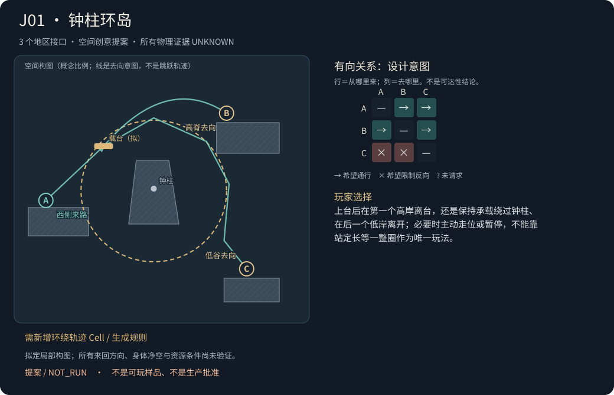
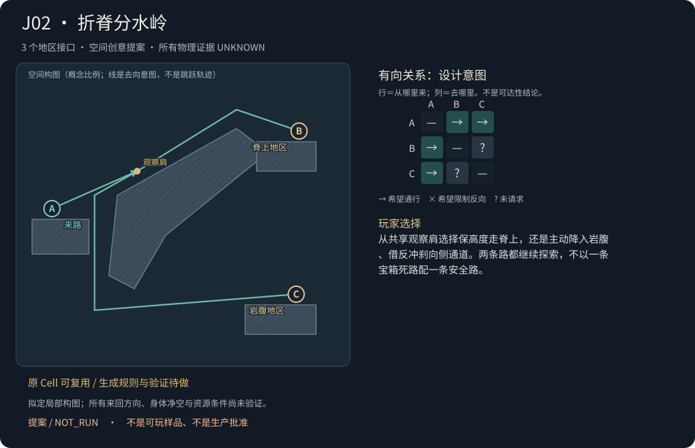
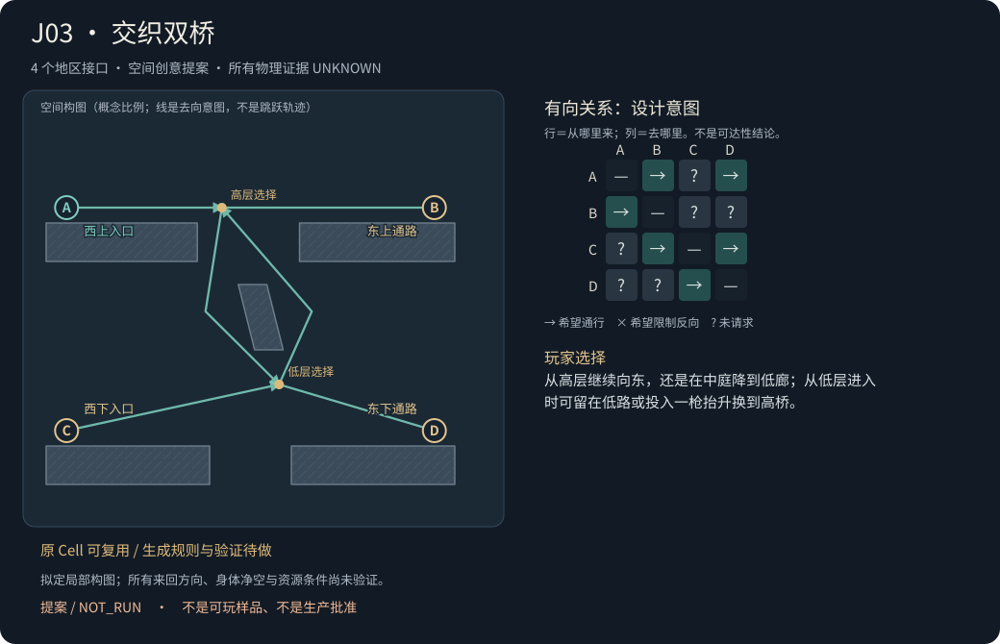
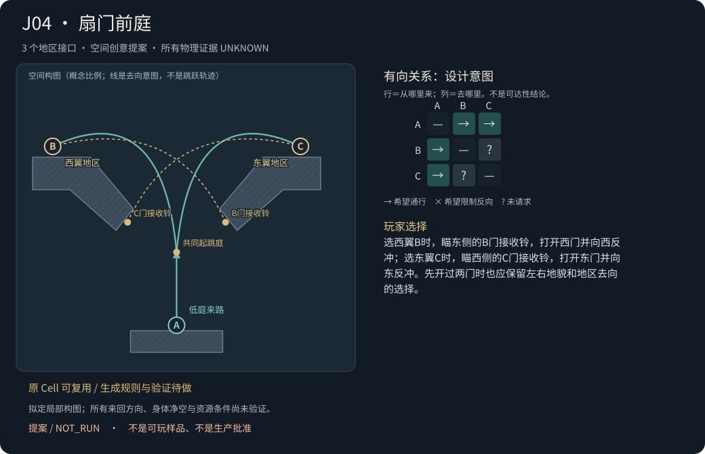
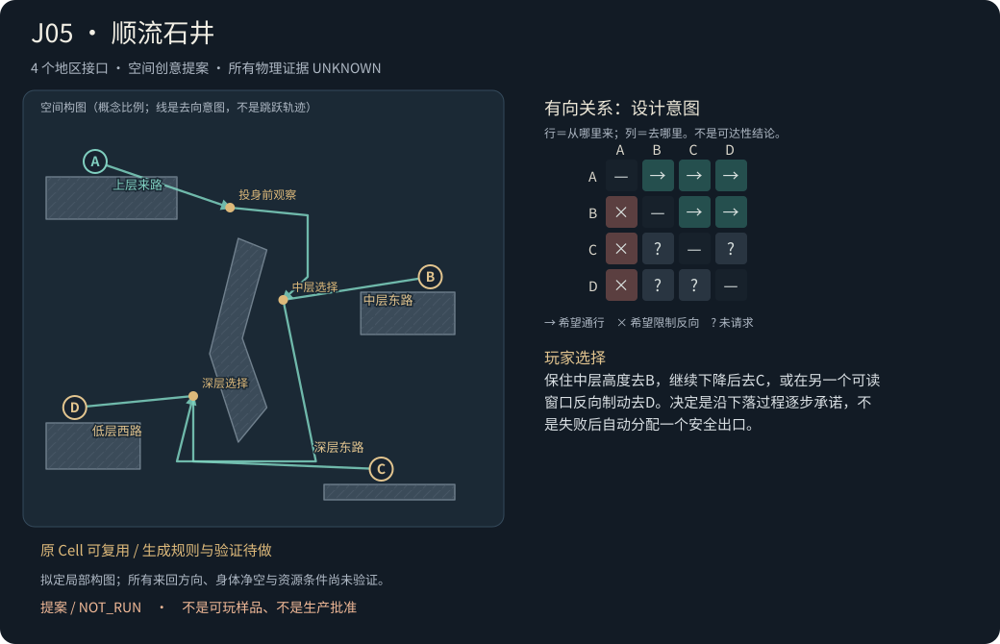
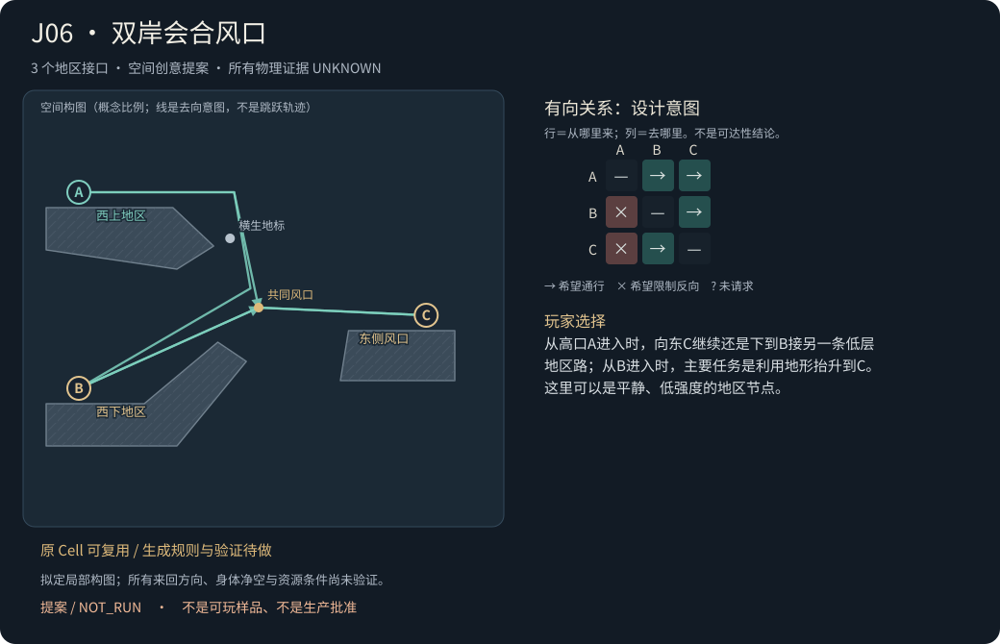

# 六个多口路口创意：先设计空间与选择

这六案都是提案，**未生成地貌、未开发Cell、未运行Godot、未入库**。图中坐标是0–100概念坐标，不是Godot世界单位或可通行轨迹。多边形仅表达岩体构图轮廓；原Cell复用指先用已有构件搭白盒，真实斜坡/新曲面碰撞需另查支持。所有有向关系的物理证据均为UNKNOWN；“希望单向”不等于已证明反向不通。

端口代表Map的地区去向/进入职责。内部失误恢复台不额外编号；奖励不是分支存在的唯一理由。环岛只是六种空间构图之一。“风口”等名字指地貌/美术意象，不默认新增风力物理。

|ID|构图与选择|端口/职责|实现缺口|
|---|---|---|
|J01 钟柱环岛|上台后在第一个高岸离台，还是保持承载绕过钟柱、在后一个低岸离开；必要时主动走位或暂停，不能靠站定长等一整圈作为唯一玩法。|3口 / interchange_with_local_fork|需新环绕Cell和生成规则|
|J02 折脊分水岭|从共享观察肩选择保高度走脊上，还是主动降入岩腹、借反冲刹向侧通道。两条路都继续探索，不以一条宝箱死路配一条安全路。|3口 / fork|原Cell可复用；缺生成规则及真实验证|
|J03 交织双桥|从高层继续向东，还是在中庭降到低廊；从低层进入时可留在低路或投入一枪抬升换到高桥。|4口 / interchange|原Cell可复用；缺生成规则及真实验证|
|J04 扇门前庭|选西翼B时，瞄东侧的B门接收铃，打开西门并向西反冲；选东翼C时，瞄西侧的C门接收铃，打开东门并向东反冲。先开过两门时也应保留左右地貌和地区去向的选择。|3口 / fork|原Cell可复用；缺生成规则及真实验证|
|J05 顺流石井|保住中层高度去B，继续下降后去C，或在另一个可读窗口反向制动去D。决定是沿下落过程逐步承诺，不是失败后自动分配一个安全出口。|4口 / directed_transfer_with_fork|原Cell可复用；缺生成规则及真实验证|
|J06 双岸会合风口|从高口A进入时，向东C继续还是下到B接另一条低层地区路；从B进入时，主要任务是利用地形抬升到C。这里可以是平静、低强度的地区节点。|3口 / fork_with_directional_merge|原Cell可复用；缺生成规则及真实验证|

建议首先比较 **J06双岸会合风口** 与 **J03交织双桥**：前者检验地貌与不同进入方向能否独立形成路口，后者检验四口真正换层。J01环岛单独列新Cell成本，不借直线平台冒充已实现。

## J01 钟柱环岛

**观察与决定。** 入口岸能看见中央钟柱、环绕它移动的载台以及高低两处离岸。三处口有不同轮廓和朝向；不是绕一圈才能知道出口在哪里。 上台后在第一个高岸离台，还是保持承载绕过钟柱、在后一个低岸离开；必要时主动走位或暂停，不能靠站定长等一整圈作为唯一玩法。

**空间构图。** 粗钟柱占据中心，载台沿柱外环轨迹运动；高岸和低岸从不同方位伸向环道。岸唇、平台宽度与视线窗口共同形成可读停靠区，不把三条直路简单排成圆形。 中央实心钟柱＋可见轨迹是统一地标；外围岸用不同高度/形状区分，中心与岸间保留完整负空间。

**动作因果。** 载台真实承载改变人物所处相位与可用离台窗口；射击反冲可用于离台、制动或选择落点。铃仅沿用启动/暂停；不假定到每个岸自动停靠，不假定切向惯性继承。

**各口去向。** A：西侧来路；B：高脊去向；C：低谷去向。这些是Map需求占位，实际地区由B提供。

**有向意图。** 希望：A→B；A→C；B→A；B→C。不希望的反向：C→A；C→B。全矩阵见JSON，所有证据UNKNOWN；不由外形或有限反向失败签no_path。

**进入方向差异。** A是观察与首次选岸；B拟可重新登环道继续换乘；C拟以下降离开，回环道列为设计不希望的方向，但证据仍UNKNOWN。

**资源、奖励与恢复。** 仅真实支持接触决定跳跃/空中枪恢复；圆周上升或下沉时是否始终接地待测。任何位置都不免费补枪或重置载台相位。 两个地区出口各可沿已选路附普通小奖励，奖励不是高岸/低岸存在的唯一理由。 内侧另有短恢复台接住一次离台失误，计划可重新登台；它不是第四个Map口。落到C后能否返环道明确待验，不能传送回A。

**最危险的廉价解。** 一枪从A直接到任意岸，环岛换乘变成装饰；长期被动等候成为唯一可行节奏，或无需读岸/选择离台就自动到达全部地区；站定承载后主动选岸仍是合理解，不强迫持续走位；在任意相位提前暂停即可当普通静止跳板；C普通跳或反冲轻易回环道，推翻预期单向承诺；旋转时只绘制轨迹而没有真实承载，或直接跟随设置玩家位置。

**与已有内容差别。** 相对旧追台/避险重接，核心是共享中心的多站换乘与离台选择；不是直线往返的装饰性改名。新家族是否成立等待实现和反例。

**Cell/规则缺口。** 当前ModuleMovingPlatformDefinition.at_time只做start/finish线性往返；完整圆周运动尚未支持。需隔离环绕轨迹Cell/定义、真实平台速度与承载、包络、存取相位和Harness/导出映射。；共享中心的岸位/轨迹/净空生成规则；错过岸后再登台及C反向反例规则。

**第一个可证伪试验。** 先验证单一环绕载台的身体承载/离台资源与多个相位，再验证同一进入前缀下B/C可选；若真实承载不稳，不用另一套物理兜底。

**后续两种适配需求。** 三口：西来岸＋高脊＋低谷，两个停靠区角度明显不同；四口：再增加背面区域接口，必须形成新的换乘去向，不把恢复台编号为第四口。

## J02 折脊分水岭

**观察与决定。** 一条折断的石脊在面前分开：上方薄脊延向远处，高处风口可见；下方岩腹形成完整弧形通道，另一地区出口从拱下露出。 从共享观察肩选择保高度走脊上，还是主动降入岩腹、借反冲刹向侧通道。两条路都继续探索，不以一条宝箱死路配一条安全路。

**空间构图。** 单块倾斜大岩同时构成脊上地面和岩腹顶棚，两个通路由同一实体解释。分叉点在岩肩，分支拥有自己的真实出口岸；没有铺满全底部的统一接盘地面。 一个长斜脊、一个明显负空间拱洞；出口轮廓分别是细长高脊与厚重洞口，靠地貌辨识去向。

**动作因果。** 保持高度或承诺下落改变接下来可用的身体通道和反冲用途；上路侧重跨越，下路侧重过檐后转向。选择后仍按原接地规则恢复。

**各口去向。** A：来路；B：脊上地区；C：岩腹地区。这些是Map需求占位，实际地区由B提供。

**有向意图。** 希望：A→B；A→C；B→A；C→A。不希望的反向：未提出禁止方向。全矩阵见JSON，所有证据UNKNOWN；不由外形或有限反向失败签no_path。

**进入方向差异。** A进入读两层去向；B返回拟沿上脊，C返回拟从拱腹用不同抬升动作回岩肩。B↔C的连续状态传递未要求，全部关系仍未验。

**资源、奖励与恢复。** 普通单跳与原空中枪，路线中的真实支持面可恢复；上/下路都不能要求未解锁能力。 奖励可分别放在两路可见的小凹位，数量接近；移除奖励后，高度、出场方向与后续地区职责仍有差异。 下路内的短台可恢复误差并重试入洞；上路失败能否回观察肩须单独测试。恢复台不作为Map端口。

**最危险的廉价解。** 下路可以无条件走到上路出口，两个去向只差拿不拿箱；统一底板让全部失误自动流到C，把C又做成安全口；入口看不见岩腹出口，选择只能靠记忆；反向需要墙跳/二跳才能完成，却按普通反冲标通过。

**与已有内容差别。** 复用跨越与过檐制动动作，但以同一岩体形成两条地区级通路；评价对象是路口构图与去向差别，不新增动作家族计数。

**Cell/规则缺口。** 折脊/岩腹共享实体的两条通路生成；入口信息与不同端口方向的连续验证；按具体跨度/落差选择支持域。

**第一个可证伪试验。** 先做无宝箱、无敌人版本，检查从同一岩肩能否辨认两个真实地区出口；若只能凭奖励辨路，先返工构图，再投入动作参数搜索。

**后续两种适配需求。** 较宽横向边界：上脊向东、岩腹向东下方；较窄高差边界：岩肩靠上，两个出口在右侧不同层，禁止自动缩放原轨迹。

## J03 交织双桥

**观察与决定。** 高桥与低廊围绕同一空心石门架穿行，两层从入口就能同时看到；中庭有真实可走的换层段。 从高层继续向东，还是在中庭降到低廊；从低层进入时可留在低路或投入一枪抬升换到高桥。

**空间构图。** 两个桥面确实位于不同y；上桥缺口和下廊台阶共同围出可见换层中庭。没有用前景/背景遮挡让角色穿过同坐标实体。 空心双拱是共同地标；两条通路在画面里错层编织，中心留出竖向亮缝，四口各贴真实岸位。

**动作因果。** 进入层决定已有高度和可用动量，换层用真实跌落/跳跃/反冲完成；同一地貌在两个进入方向承担不同动作关系。

**各口去向。** A：西上入口；B：东上通路；C：西下入口；D：东下通路。这些是Map需求占位，实际地区由B提供。

**有向意图。** 希望：A→B；A→D；C→D；C→B；B→A；D→C。不希望的反向：未提出禁止方向。全矩阵见JSON，所有证据UNKNOWN；不由外形或有限反向失败签no_path。

**进入方向差异。** A有继续/下降，C有继续/上升；B与D反向先只请求同层通行，其他换层方向不得由对称外形推断。

**资源、奖励与恢复。** 上下层的支持面恢复各自实际跳跃/空中枪；低层升高要付出动作成本，不能因切换路线试验默认补资源。 两层可放小额沿路奖励，但四个端口本身全部服务独立外接通路；中庭没有必须拿箱才成立的伪分支。 换层失误落到中庭内台，拟能选择回低廊或重试上升；内部台不增加第五个口。失败后保持机关、金币与原资源状态。

**最危险的廉价解。** 美术上像交织，实际只有一条连续水平路；低层普通走路就能到B，抬升选择失去成本；四口仅是在同一长地板上标四点，没有换层职责；上下路线的试件用了不同碰撞体或奖励集合；将A到D和C到B的独立成功当作任意状态换乘保证。

**与已有内容差别。** 相对旧高奖励/低主路，是两个真实进场层共享一个换层中庭；目标是换乘节点，不是单入口加两处低风险出口。

**Cell/规则缺口。** 四口错层几何及可见换层中庭规则；两个入口的共同决策点和独立有向关系验证；不同高度/左右方向的状态相容性验证。

**第一个可证伪试验。** 优先做只含静态岩体的双入口对照：同层连续通过与换层确实不同，并检查两口外接空间互不被桥体占用；无新Cell即可检验路口美感。

**后续两种适配需求。** 横向宽四口：A/B同层、C/D同层，中庭偏中央；纵向紧四口：换层中庭偏一侧，上下口有错位；不以复制左右镜像作已验复用。

## J04 扇门前庭

**观察与决定。** 低处入口通向宽前庭，两侧向上展开为不同地区门洞；每扇门各有可读的铃和连线，玩家能在起跳前看见两处出口。 选西翼B时，瞄东侧的B门接收铃，打开西门并向西反冲；选东翼C时，瞄西侧的C门接收铃，打开东门并向东反冲。先开过两门时也应保留左右地貌和地区去向的选择。

**空间构图。** 中央低庭提供观察与起跳，左右翼门洞向上张开；铃位于与身体去向相反的射线窗口。遮檐需让地面预射击与空中射击有真实区别。 扇形两翼围绕同一前庭，门洞高度和外侧岩纹显示两片地区；铃色与连线服务读图，不靠换颜色制造玩法。

**动作因果。** 接收铃的物理位置与它控制的门分开：B门接收铃在东侧，控制西翼B门；C门接收铃在西侧，控制东翼C门。原弹丸打开该路线的独立短门，同枪反冲把身体送向该路线。两门彼此独立，不假定“开左关右”或自动互锁；当前一枪资源只限制这次空中尝试，不禁止合理准备。

**各口去向。** A：低庭来路；B：西翼地区；C：东翼地区。这些是Map需求占位，实际地区由B提供。

**有向意图。** 希望：A→B；A→C；B→A；C→A。不希望的反向：未提出禁止方向。全矩阵见JSON，所有证据UNKNOWN；不由外形或有限反向失败签no_path。

**进入方向差异。** A进入有双翼选择；B/C返回可用与去程不同的下降动作。未验证B到C的跨庭连续状态，不默认因为两门都能开就互通。

**资源、奖励与恢复。** 空中枪与冷却沿用原机制；前庭落地按真实组件恢复。门开启时间要根据实际弹丸飞行/人物运动/完整身体通过求解，不是一帧窗口。 两翼可各放等量可选奖励；门后各自继续通往地区。不能把一翼仅做宝箱袋，另一翼才有Map去向。 错过一翼门时落回内部前庭，原防夹和安全关闭保留；门内返程拟用原add_access_bell或真实落回前庭，具体逐方向验证。

**最危险的廉价解。** 在地面无限次预开后，射向与选翼完全无关；若地区去向仍清楚可作为准备解保留，但不宣称同枪必要；两翼路线其实同一高度/节奏/落点，只是换铃颜色；门独立，却文案假称互斥选择或自动关另一门；从前庭直接普通跳绕过两门，门成为无意义摆设；门关闭后把玩家夹在无恢复点的小袋。

**与已有内容差别。** 沿用旧短门和反冲，但双翼是两个继续探索的目的地，共享起跳庭与可见选择；是否比简单左右岔更有体验价值要靠实际试件判断。

**Cell/规则缺口。** 前庭双翼/相反射向窗口规则；双门预开、相位错开与失败恢复反例规则；若未来要求开左关右，那是当前不支持的新互锁Cell，不能偷偷补行为。

**第一个可证伪试验。** 先验证两个翼在同一进入状态下都可选择，再测地面预开/双门预开；若预开后仍是有效地区岔口则保留为允许策略，不强加唯一按键。

**后续两种适配需求。** 对称外扩两翼：面向相反的地区口，动作窗口相近；非对称两翼：一侧抬升、一侧先降后抬；仍必须有两条有意义去向而不是安全底口。

## J05 顺流石井

**观察与决定。** 高处来路俯看一口分层石井：中层东岸、深层东岸、低层西岸的洞口轮廓各异，从投身之前就能辨认三条地区去向。 保住中层高度去B，继续下降后去C，或在另一个可读窗口反向制动去D。决定是沿下落过程逐步承诺，不是失败后自动分配一个安全出口。

**空间构图。** 细长中央石刃把下降空间分成两个可读空腔，三处边岸各接真实侧向地区口；底部不铺一整张公共接盘平台。 纵向石井＋偏心石刃形成强剪影，洞口用不同拱形、台阶朝向和光线提示层次；不是任意撒三块落脚台。

**动作因果。** 重力持续改变可用高度，反冲用于制动/转向/选择身体落位；上层机会错过后不免费回溯。单向来自拟定落差、遮檐与可达边界，而不是程序禁止反向输入。

**各口去向。** A：上层来路；B：中层东路；C：深层东路；D：低层西路。这些是Map需求占位，实际地区由B提供。

**有向意图。** 希望：A→B；A→C；A→D；B→C；B→D。不希望的反向：B→A；C→A；D→A。全矩阵见JSON，所有证据UNKNOWN；不由外形或有限反向失败签no_path。

**进入方向差异。** A进入有逐层选择；B拟还能下转C/D；C/D拟不回A。这里只记录单向设计意图，下降本身、反向测试未成功或未知绝不等于已证no_path。

**资源、奖励与恢复。** 只有实际触及中间支撑面才恢复资源，不能在每个出口窗口自动补枪。最大抬升包络/反向可达性需按原角色与当前资源实测。 奖励沿不同岸可取可不取；三个出口各自是继续探索接口。移除箱子仍有不同方向与高度承诺。 漏过B可落到井内短台，再选择C或D；该短台不单列第五口。若连C/D也错过，必须有经验证的内部恢复或明确失败成本，不能偷偷传送。

**最危险的廉价解。** 一枪向上或沿井壁普通跳就回到A，推翻预期承诺；三个岸其实都在统一底板上，随便走就能补选；地貌遮住后续口，玩家只能盲跳；为了强制单向新增看不见的墙/禁用反向输入；下落速度导致极窄一帧离台，或恢复点被放到必经奖励外。

**与已有内容差别。** 以连续下降时的路径承诺组织多个地区端口；区别旧过檐刹入单箱袋，也区别把任意漏接点直接当安全出口。

**Cell/规则缺口。** 分层石井与各岸身体窗口生成；当前能力/资源反向可达包络与反例规则；不同到达层的继续通行/恢复策略；no_path需独立结构性证据，当前不能签。

**第一个可证伪试验。** 先用真实原动作搜索能否轻易逆回A，并验证三个出口窗口的容错；若单向不成立，只能改设计意图或改几何再验，不能把UNKNOWN写成no_path。

**后续两种适配需求。** 四口：上入、中东、深东、低西；保留三种真实去向；三口：移除一整条地区通路并重作岩体/决策，而不是仅删标记复用旧证据。

## J06 双岸会合风口

**观察与决定。** 两条西侧来路一高一低，绕同一棵横生老树/石拱进入明亮风口；高处能看见低层来路与东岸，低处能仰见自己暂时够不到的高来路。 从高口A进入时，向东C继续还是下到B接另一条低层地区路；从B进入时，主要任务是利用地形抬升到C。这里可以是平静、低强度的地区节点。

**空间构图。** 高低两条来岸形成不对称三角，围住一个共同风口。A到B有真实下行段，B到C是可读缓坡/短台链，A到C沿较高边缘跨过空心处。B/C都接外部地区，内部恢复台另置。 老树横枝或天然石拱作为方向参照，中央负空间让玩家看懂来路层次；用斜线与留白构成路口，不靠机关密度。

**动作因果。** 同一地貌把高处的重力优势和低处的上升成本分开；是否需要反冲由实际坡阶支持域决定，绝不为证明多口而硬塞铃或敌人。

**各口去向。** A：西上地区；B：西下地区；C：东侧风口。这些是Map需求占位，实际地区由B提供。

**有向意图。** 希望：A→B；A→C；B→C；C→B。不希望的反向：B→A；C→A。全矩阵见JSON，所有证据UNKNOWN；不由外形或有限反向失败签no_path。

**进入方向差异。** 从A是向C/向B的地区分叉；从B是向C抬升的汇流；从C拟可下降回B，却不一定回A。同一场所因进入方向承担不同职责。

**资源、奖励与恢复。** 低强度版本可主要步行与普通跳；抬升差较大的需求用原反冲。每个台阶按真实接地恢复，不新增免费补给。 可无奖励。若放小收集物只用于引导观察，不承担“选哪条路”的唯一动机。 低层内部错步可沿短坡回风口继续，不把每处落脚台当端口。A来路若拟不能从B/C原返，必须在进入前可读，且由新证据确认。

**最危险的廉价解。** B只是A路线的安全接盘/回入口，没有真正外接地区职责；A/B/C只是同一条长走廊上的三个标记，缺少分支；强行塞机关令原本可读地貌变成参数挑战；因外观三角就默认所有方向互通或默认上行不通；低层反冲轻易回到A，却仍宣称有单向承诺。

**与已有内容差别。** 把部分单向、汇流与分叉放在同一可记忆地标；允许简单步行节点成立，不自动计为新动作挑战家族。

**Cell/规则缺口。** 不对称三角地貌与共享风口生成；高/低/东三种进入方向的实际职责与视线检查；设计不希望的反向须独立验证，当前UNKNOWN。

**第一个可证伪试验。** 优先做无宝箱/无机关静态白盒：从高口能读出B/C两个地区去向，从低口能看懂不同的抬升关系；如果B仍只像恢复口，先改Map端口职责与构图，不加难度。

**后续两种适配需求。** 横向宽风口：高低西口相距明显，东口居中；紧凑竖向风口：A/C较近，B在下层反向接路；保持真实分岔，不靠镜像猜可用性。

## 设计与验证边界

J05图中的跨空腔连线绕过石刃尖端，可能需要反冲回升；它仍是空间意图，需先验证空中资源和净空，不能当作穿岩或可行轨迹。J04使用两个原本独立的ShotLatch短门，没有“开左关右”的原子互锁；若以后需要，必须新增缺口，不默认实现。J03上下桥位于真实不同高度，不能用前景/背景视觉穿过同一实体。J05与J06的上行限制仅是待反驳设计意图。J01目前平台代码只有start/finish线性往返，没有圆周轨迹或已验证惯性。

本批来源为实际当前Codex子代理创意输出，原Cell代码与两条人工原话的SHA保存在 [结构化设计卡](../../pcg/creative-production/junction-ideas-v1.json)。未调用外部创意API，未训练模型；没有人类评分、试玩或生产批准。
