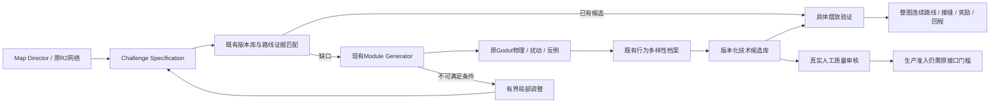

# Map 驱动的 Module 库闭环 v1

任务 `MAPGEN-GROWTH-01`，2026-10-24；沿用 PR #1 / `research/l4-map-generator`。

本轮已经实际完成：R2 小环职责 → Challenge Specification → 搜索现有模块 → 缺口反馈 → 有界空间调整 → 需求生成 → 原 Godot 留出验证 → 版本化候选 → 具体地图拼装与连续路线 → 视频和试玩包。

**这是小型技术闭环，尚未证明高质量大区域生成。** 当前具体消费者只支持“三端口分叉汇合 + 后续上升”这一种 motif；连接段偏长，难度和趣味仍待人工评价。所有通用拼装与生产准入保持关闭。

## 最新 main 与复用边界

- 开始时检查并合入 map-edit `main@b9318cf82cdd182645b4b42137e5e8eaaeb75731`，合并提交 `9d308e4`。保留 main 新模块生成器、三端口输出契约、43 项契约检查和既有媒体；只解决 README、package scripts、Pages 打包三处冲突。
- 主游戏只读更新到 `main@26e7f2a4`。Module Generator 的物理原件仍绑定 `12f6cb006d7119598e3235f4ca4f7323e4c9d092`，没有改版本标签冒充迁移。870 份原件与最新游戏对照：840 字节相同，30 有变化、0 缺失；变化包含表现、App/UI 和 weapon_action_runtime，因此不签当前正式 Demo 全流程兼容。对照明细见 `pcg/results/map-directed-loop-v2/latest-main-audit.json`。
- 复用 PR #1 `region_network.core_network` 生成核心网络并提取四场所环；使用原 Mission/Exploration 字段和 `mapgen.validate_graph`。未另写一套拓扑或能力求解器。
- Module 仍是 Map Notes `gunman-rush-level-sketch/v1 + generationContract`，继续使用 `module-contract.js`、既有导出器及 `assemblyInterface`。没有创建第二套 Module 几何格式。
- 真实生产/验证复用现有 `synthesis.proposals/materialize`、`PlainsEngine`、`BehaviorArchive`、regular 技术门槛、独立扰动及替代策略；使用仓库三项 pcg Skills。没有逐模块在线大模型调用。
- 现有生成器只增加可选 `heights` 参数，默认行为与 main 一致；现有 Simulator 只增加可选 runner 路径，默认入口不变。新地图观察器继承原 runner，不另实现 PlayerMotor、资源、伤害、锯轮或风铃。

## 闭环如何运行



Director 负责主路短成本、可选高台、汇合休整、回访入口和出口钟台的职责，目标节奏为“观察→路线选择→动作挑战→恢复→短上升”。R2 提取的环只负责小型网络职责；当前消费者将其降为同一物理 motif，**不声称不同 Seed 已生成不同真实区域布局**。

代码入口：`pcg/map_directed/director.py`、`library_bridge.mjs`、`fill.py`、`library.py`、`composition.py`、`run.py`。

## Map → Module 需求契约

`map-notes/challenge-specification/v1` 是需求格式，不是新 Module 输出格式。实物示例见 `pcg/results/map-directed-final-v1/challenge-specifications.json` 及 `effective-challenge-specifications.json`。

| 字段 | 本轮含义与支持范围 |
| --- | --- |
| objective / region | 场所的探索职责及平原主题 |
| ports | 端口数量、要求朝向；不假定端口任意互通 |
| relations | 指定方向和主路/奖励/回程职责；当前补缺器只接受 entry→exit/main，反向或新增方向明确拒绝 |
| capabilities | 复用既有 defined/allOf/anyOfGroups；当前仅移动、单跳、反冲 |
| resource_state | 进入/离开及不重置世界的要求；具体数值由真实输入前快照、过缝前后状态及终点观测提供。通用状态范围仍 UNKNOWN，不以文字要求签成功 |
| difficulty | 路线节奏与动作深度意图；human_score=null，未把机器人成功率换成1–10难度 |
| risk_reward | 高路可选、12金币、无强制伤害；真实接触后调用原交易服务 |
| space | 真实占用宽高、端口跨度、入口高度与所需上升量 |
| adaptation | 当前只支持平移和显式连接Cell，不缩放、旋转或虚构端口 |
| validation / budget | 原 Godot 验证、具体地图复验；最多一次局部空间修订、两次生成调用 |

这些字段既有硬约束，也有尚未被自动评分的设计意图，不能混为全部已求解。进入状态不是任意可接受区间的证明；只有声明的具体策略与采样覆盖得到技术回执。

## 真实需求补缺与入库

1. 搜索 main 公开的8个 Module 契约，逐份用 canonical JS 验证内容版本。选择 T01 的既有三端口路线证据，真实原件 SHA 和 raw case 对应关系重新检查。其通用 `assemblyInterface` 仍不通过，选择的是隔离实例验证候选。
2. 钟台要求：两个端口，西入东出，入口 y=420、出口 y=320，上升100；不要求额外移动能力。现有两端口候选没有这一高度关系，不靠改名伪造命中。
3. 初始真实占用预算900。生成器执行8次实际运动探针，3个可构造候选均因1600宽坑底占用被拒；失败返回 `spatial_width_exceeds_max`，而非把端口跨度当实际宽度。
4. Director 只修订一次占用预算到2000，保留拓扑、能力和挑战意图，再调用原生成器。8探针→3个真实落点候选→clean/mild校准→既有行为档案选择1个→独立留出与反例。
5. 技术结果：clean **1/1**、mild **12/12**、moderate **11/12**；12个有限替代策略均未无伤稳定完成。原 regular 门槛通过，仍保留那1次 moderate 失败。确定性静态 clean 不重复12份冒充覆盖。
6. 新模块通过原导出器输出既有契约，加入版本化候选库。真实占用 `[-350,158,1600,510]`；技术状态 `passed_scoped`，人工状态 `awaiting_review`，生产状态 false。
7. 入库后重新从磁盘查询，命中新模块，不调用生成器。后续新进程 `map-directed-loop-v2` 也实际从库复用，没有生成调用。

最终冻结代码的**单命令完整执行**为 `pcg/results/map-directed-final-v1/`：59次需求相关物理（失败请求8 + 补缺51），随后12次具体整图；总墙钟约30.6秒，含冻源/导出/验证，不是 Runtime 生成成本。final 独立库记录在其 `library/candidates/`，精确版本见 summary，避免把守门修订前的候选重标为新源码执行。

库守门不仅核 case/doc 各自的文件 SHA，还核 `module_hash(raw) ↔ canonical generation.source.moduleSha256`、源 case ID、module ID、内容版本及物理原件。错配几何不得借旧文档入库。

候选库不会因技术通过而进入生产：沿用现有人工审核数量门槛，且仍需 canonical 拼装接口准入。当前真实人工审核/生产模块数都是0。本轮只实现候选存储、复用和生产拒绝守门，没有伪造批准记录或宣称生产库已增长。

## 具体地图与验证结果

具体地图由：T01三端口场所 + 新需求钟台模块 + 一个独立版本化安全连接Cell 组成。保留实际尺寸，按完整占用不重叠放置；没有把示意图格子放大后当物理平台。

| 连续策略 | 必须完成的职责 | 四初始锯轮相位 |
| --- | --- | --- |
| main | 入口→下层观察→汇合→接缝→钟台 | 4/4 |
| reward_rejoin | 高台击钟→实际领取12金币→回落汇合→钟台 | 4/4 |
| reward_return | 高台取奖→实际回到入口→再走下路完成 | 4/4 |

所有路线在各自一次连续世界中执行，无中途传送、补资源、重建机关或切换模块 fixture。四相位是有限采样，不是任意相位/能力/操作下的全图证明。

- 12/12：HP5，无真实伤害、危险接触或回退；正确完成有序检查点、要求的真实风铃事件及实际奖励交易。
- 24次具体接缝跨越：连续相邻帧跨过指定界面，身体在合法区域、双方落地、HP稳定，无新增伤害/回退；保存速度、弹药、精力、冷却及动态时钟。不是仅“走进接缝框”。
- 奖励使用原 `SimpleRoomReward + RunWallet + DemoLifetime`，未直接增加角色或钱包数值。
- 三个实际反例均拒绝：删连接平台造成真实受伤；取消钟台射击卡门；走低路无法冒领高台奖励。
- 首次整图3/3失败保留：旧 settle 目标覆盖下一段前进输入，错过风铃；出生检查点观测在起跳后发生。修复续接输入与观测器后重新验证，未改核心物理或降低成功条件。

**没有证明的范围**：任意不规则 Macro 布局、任意状态传递包络、所有反向路线、正式 Demo 保存/战斗/Boss、玩家手感、完整区域艺术与肉鸽复玩质量。当前较长安全连接段是明确的节奏弱点，不作为优质探索设计样板推广。

## 实机媒体与试玩

目录 `generation/maps/map-directed-loop-v1/`：

- `whole-map.png`：真实 Godot 整图1600×900，镜头适配，未搬角色。
- `sample-01.mp4`：主路10.07秒。
- `sample-02.mp4`：奖励汇合10.05秒。
- `sample-03.mp4`：奖励回访12.47秒。
- `all-routes.mp4`：正常速度32.58秒，60fps；各片完整尝试后冻结1秒，拼接位置明确。
- `manifest.json`：原生媒体与逐帧绑定。1760动作帧运动、资源、时钟、机关及事件精确；接缝首碰撞支撑排序的4/2/9处差异保留原ID并以同高相接平台+真实身体扫掠作限定几何等价，不声称全部字段逐字一致。
- `play-v7/`：独立 Godot Web 包，复用原不可变68MB base和官方JS/WASM，新增包独立SHA；实际浏览器/公开发布结果以回执为准，不用旧入口冒充。

## 复现与最小检查

先按 `pcg/WORKSPACE.md` 恢复官方4.7.2与实际归档。另恢复三端口生产原件和后续动态素材，均逐SHA、不覆盖修改：

```sh
python3 pcg/tools/restore_archive.py godot-runtime-v1 --extract
python3 pcg/tools/restore_archive.py plains-generation-v1 --extract --prefix prototype/godot/assets/plains_v3/enemies/meadow_actions/
python3 pcg/tools/restore_archive.py plains-three-port-v1 --extract --prefix results/plains-three-port-production-v1/
# 审查旧失败和本轮精确冻结源时恢复；正常运行不要求先恢复旧失败：
python3 pcg/tools/restore_archive.py map-directed-source-and-failures-v1 --extract
pcg/toolchain/Godot_v4.7.2-stable_linux.x86_64 --headless --editor --path pcg/prototype/godot --quit

# 新目录、新的空候选库：完整体验需求→补缺→入库→整图验证
python3 -m pcg.map_directed.run --name map-growth-rerun \
  --library-root pcg/results/map-growth-rerun/library

# 新进程复用同一库，避免再次创作；新摆放仍重新验证整图
python3 -m pcg.map_directed.run --name map-growth-reuse \
  --library-root pcg/results/map-growth-rerun/library

npm run check
npm run check:mapgen
python3 -m unittest discover -s pcg/map_directed/tests -v
```

交互与录像命令见 `pcg/map_directed/godot/README.md`。离线CLI默认拒绝覆盖结果、候选版本及物理文件。CI只执行相关契约、原factory/plains及L4最小测试，不运行全游戏矩阵或在CI在线搜索。

独立审查分别覆盖 Director/库/拼装/观察器和 fill/原生成器扩展，作者不自签自己实现的部分；机器技术结论不签人类趣味。精选证据与失败归档说明见本轮工作台。

归档 `pcg/archives/map-directed-source-and-failures-v1/manifest.json` 保存首轮失败、重复审计批及各阶段精确源码；主流程的输入、压缩物理输出、摘要、库记录保持直接可读。归档原件不删除、不倒签；恢复工具逐文件核SHA且拒绝覆盖修改。
