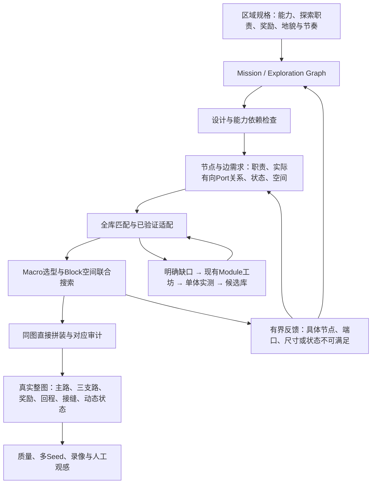

# Map要求重新核对与实施路径

本轮结论：保留Graph＋Block128＋Module方向及已有物理/候选库/空间求解内核；**废弃五段分叉串联骨架及其专用选型、路线和录像入口**。当前没有符合完整要求的可玩区域，不能把旧43实例图当作下一阶段默认输入。

本次完成了旧路径删除、设计验收补缺、真实拼装入口的蓝图对应检查，以及三个固定Seed的既有逻辑规划器审计。没有生成新物理地图、没有新Godot录像，不把这些修改称为完整Map系统已实现。最新main仍为54d0cfc；本轮不修改主体游戏。

## 一、哪些要求必须保持

下表是实施和审阅的对应表。策略值继续读取`pcg/map_directed/block_grid/plains-policy.json`，不另建一套相互冲突的数字配置。

| 要求 | 具体实现与证据 | 当前状态 |
|---|---|---|
| Graph驱动整个地图 | 同一Exploration Graph传给需求、候选域、搜索、拼装、验证、可视化；输入图/策略/需求哈希绑定；节点和边均有物化对应 | 规划器与需求已有；通用物化待接。原assembler/audit已接蓝图检查 |
| 128×128 Block、自由轮廓、边界中心Port | 原整数Block搜索、真实岩体/危险/动作净空、四向Port，不把包围矩形做外墙 | 内核保留；实际模块逐版本资格仍有限 |
| Module直接拼接 | Port坐标重合、法线相反、开口兼容，真实状态可接续；Map新增平台/通道/壳体为0 | 原assembler/audit保留；不能用新增落脚链解决困难闭合 |
| 2～3条有差异的主路 | 路径真实存在、方向正确、起止正确、可到实际Boss；允许共享地标/前庭，避免重复强制汇合；按动作、风险、成本和空间体验区别 | 原R2规划器可生成逻辑路径；实际任意图与Boss未物化 |
| 折返奖励支路 | 主网入口→2～5个挑战实例→奖励，沿原路径在同一角色/机关状态下返回 | 有旧单段证据；新的深支路组合待验 |
| 单向环回奖励支路 | 主网入口→挑战→奖励→不同回程连接回入口；真实方向/捷径开启与资源可用，不是普通段间下落 | 逻辑类型已覆盖，真实拼装待验 |
| 汇合奖励支路 | 主网入口→挑战→奖励→汇入原主路或另一主路的另一个位置，可向前或向后 | 逻辑类型已覆盖，真实拼装待验 |
| 奖励、恢复、商店、隐藏与Boss | 各类独立数量/价值预算、真实运行服务和取得事件；高价值对应额外风险/挑战成本；主路有基础成长 | 逻辑分配存在，主要道具/价值标定/Boss等接口阻塞。金币不代替构筑道具 |
| 地貌与协调感 | 不规则连续岩体、岩唇/台阶承载恢复，挑战的观察/起跳/空中净空/失败区与地标共同构图 | 尚未达标；不能根据布局可行或贴图迁移判美感通过 |
| 平原以空中射击反冲为核心 | 从真实已验证动作关系选择挑战，控制走路、等待、恢复和高压力段的节奏；风铃门检查便宜绕过，移动平台按玩法职责使用 | 单体部分具备；整图密度、必要性和重复仍待验证 |
| 区域特色可配置 | 区域Profile定义能力/生态、任务规则、拓扑变换偏好、空间方向与开放度、奖励节奏和地貌主题 | 有区域逻辑参数；完整统一接口待接，不为每区域复制求解器 |
| Map驱动库增长 | 全库搜索→已验证适配→明确缺口请求→现有Module工坊→实际物理→版本化候选库；人工趣味/生产准入分离 | 旧有限闭环可参考；通用Graph请求到现有工坊尚未接通 |
| 多Seed探索变化 | 固定Seed批次，比较去坐标/命名/镜像后的拓扑和任务、路线、动作/内容差异；全部失败保留 | 本轮只审计三个逻辑计划，绝非三张可玩地图或多样性准入 |
| 整图可玩与无软锁 | 能力/机关/资源状态下可达、奖励后退出、关键路线和回程、动态碰撞/端口接缝逐项验证 | 有旧有限具体轨迹工具；通用状态空间与新的完整区域待验 |

规模目标继续为40～65真实Module实例、5～8条奖励支路、5～10主要枢纽、3～5地标。主路8～15实例、奖励支路2～5实例；共享实例只计一次。7～10分钟最短熟练通关与10～20分钟较完整探索需要真人校准，不把自动回放时间乘常数凑成目标。

奖励价值应先从主游戏现有掉落、道具、商店和成长曲线提取基线并校准；当前null表示未完成标定，不表示无限预算，也不应把它变成等待用户重新提供方案的理由。

这些数量是初始区域Profile，最终应由真实时长和内容密度校正。不能为了通过验收缩减必需的路线类型或把空白/重复模块拆成多个计数。当前规划器用节点估算放置槽位；未来Macro包含多个L2时，必须根据物化组件重新统计，逻辑节点数不能冒充实际Module数量。

## 二、本轮具体删除与修正

已删除`content_domains/region_build.py`、`region_run.py`、旧小图`run.py`、依赖首段上下路的`key_route.py`及专用`review_content_region.py`。`content_domains/build.py`只保留库资格、动作标签和Port重命名工具，删除其中的固定小图生成/拼装。没有legacy开关、备用默认骨架或自动回退；旧源和地图留在历史提交/归档中作失败证据，不进入新生成路径。

保留`block_grid.plan`作为**逻辑**规划入口，复用已有`region_network.construct`。它输出真实网络、主路、三种支路、分离奖励分配、需求和输入绑定。目前工坊对`block-native-*`请求仍返回needs_design，这就是适配缺口，不是已经完成Module补缺。

`block_grid.policy`已补：三种要求的支路必须齐全；返回目标、逆向边、主网汇入、主路线重复/起止/真实有向边等检查；不能把可选支路算必经主路。环回/汇合允许`return_nodes`表达多模块回程，不限奖励房到主网的一条直接边，并按去重后的整条支路统计预算。原43实例图即使提交物理全通过，也会被设计策略拒绝。

同时通过现有technical-withdrawal机制将相关67个旧Map上下文payload全部标记退役（其中7个此前已撤回），避免新查询读到已退役骨架的源绑定或把它们当作通用Graph库存。旧记录及其有限物理证据不改；94份原Module父版本没有被撤回，独立内容可在新接口下重新适配验证。

`direct_join.assemble`现在保存真实调用者图的绑定与独立副本，调用`materialization_review`检查节点、边、端口对应；原`audit`检查后续篡改图或丢失实现。当前是一节点一放置实例的契约，Macro内部可以有多组件；以后若要一节点对应多个放置对象，必须增加显式实现映射，不得改图掩盖缺项。

保留的通用输入扰动工具`region_holdout`在启动Godot前执行设计策略；设计失败写design_rejected/NOT_RUN。新的物理留出结果只叫physics_all_passed，不用它宣称区域要求已全部满足。

新增Map Director skill只负责约束后续工作方式，**不能代替代码检查**。本轮已经添加旧43图拒绝、三种支路缺失、假汇合/回程、伪主路、蓝图丢节点/边、真实assembler/audit接线等回归检查。

## 三、架构应该怎样接起来



Graph不先规定五层、上下轨道或哪层必须某个模块；也不等空间搜索失败后再随意补奖励。空间求解必须提前考虑库存的尺寸和有向动作关系，必要时反馈并局部改图，但须保留主路、三类支路、奖励、能力和回程职责。

原R2当前先生成区域网络，再选入口/前庭和扩展奖励职责；它还不是完整的Mission-first实现。本轮用它恢复已声明要求的逻辑审计，不把它当最终算法已完成。下一阶段应在同一入口接Mission规格，预先确定任务、能力/机关依赖和奖励职责，再由网络生成/变换满足它们；不能只在随机图完成后贴角色标签。

**通用物化是下一阶段最大的代码工作。** 不能简单把旧`g['stages']`换成新的JSON路径。它应逐节点枚举候选Macro的真实Port与相邻边映射，再按路线产生必须支持的有序关系：从哪口进入、选择哪口离开、奖励后怎样返回。不能默认同一枢纽所有Port互通，也不能把每次挑战都强制改成同高、停稳、满资源。未知接口报告needs_design。

空间求解仍用原有界CSP，保留整数Block闭合、真实实体、身体净空和动态包络过滤；128格中的空气共享是明确实验选项，不能隐瞒它与整格独占的差别。首先测实际不可满足原因，再决定增强回溯、几何优化或离线ASP，而不是在输入图仍错误时换算法名字。

保留内核不等于它已支持全部动作接口。`shape_search.compatible_state`目前只接受grounded_dock，使用有限的落地、射击资源和速度条件；拼装侧也主要支持落地侧接缝和有限竖向转接。真实空中高速进入、连续反冲衔接、钩索进入等，需要扩展状态区间/能力条件的蕴含检查和对应接缝物理验证，不能只取消同高筛选就宣布支持。新阶段必须明确哪些接口已实测、哪些仍UNKNOWN；也不能默认下一段落地回满来掩盖状态缺口。

Module库存匹配从整个库按职责、能力、动作、端口、形状、难度和资源条件建立候选域，不写bell/尖刺/齿轮的固定槽位名单。优先复用，缺口才生产；镜像和加宽是新版本适配，不能计作新创意。Map仅提交请求，不另造候选库、角色物理或一套小Module生成器。

若只是缺某个有序Port对的证据，应先请求现有Verifier做真实连续穿越/状态验证；仅有两条“入口到中心、中心到出口”的独立满资源见证不能自动得到该Port对的保证。只有几何/玩法确实缺失时才进入新内容创作。所有真正单向落差还需检查取得奖励后能到安全出口/主网，不能只证明从出生能到Boss。

区域输入可以不同：平原偏反冲跨越、开阔视线和岩崖；森林偏钩索、竖向交错和树冠/林底绕行；地穴偏洞室/竖井与深层返回。输入应是机制和拓扑/空间偏好、限制与可用库存，不能直接给三套固定空间骨架。

## 四、验收如何防止再次偏离

每次输出独立记录design、content、space、physics、quality、human各阶段。只要某阶段缺证据，就保留UNKNOWN/NOT_RUN；禁止一个含混的all_passed覆盖整套目标。

| 阶段 | 必须检查 | 不可替代的东西 |
|---|---|---|
| 设计 | 主路、三类支路、可达/返回、奖励类别、目标规模、能力依赖；结构不是重复串联选择 | 多节点、多回环、换Seed均不自动通过 |
| 内容 | 每个职责落实到具体已验证玩法，奖励/商店/Boss有真实服务，缺口明确 | family标签、Module单体通过、金币不能替代实际内容 |
| 空间 | 同图节点/边对应，Port、轮廓、净空、状态兼容；无Map补平台 | 逻辑图或更漂亮的概念蓝图 |
| 物理 | 一角色连续通过各主路和三类奖励取回，真实动态、资源、能力锁与便宜绕过 | 新建满资源单段测试、只覆盖主路、理论连通性 |
| 质量 | 主路/支路真实成本、风险收益、回环回程价值、重复内容/水平带/枢纽/空白、可读性与多Seed差异 | 单一加权总分、回环数量、自动动作次数 |
| 人工观感 | 同世界整图和可下载路线片段，记录用户对探索、节奏、美感的反馈 | 自动通关率不能代表趣味；不强制用户亲自试玩 |

美感和设计感不能由几条计数检查保证。程序先筛明显重复和不合理结构，再展示同图的完整地貌与路线供实际反馈；不能因技术检查全绿就宣布超过主游戏。与主游戏比较时同时报告新方案的收益和仍落后的地貌、生态、节奏、容错、流程完整度。

失败反馈至少含：节点/边ID、需求和候选版本、缺失能力/资源状态/Port有向对、可接受形状和端口偏移、几何冲突、已花预算、允许保留职责的局部修订与Module补缺请求。重试和生产调用均用预先声明的有限预算；不能删边、降挑战或把混合支路改为全折返。

## 五、后续按这条路径实施

1. **本轮：清除污染并建立可执行验收。** 删除旧固定入口、补策略与真实拼装对应检查、审计旧图及三个逻辑Seed，明确通用物化仍未实现。此阶段不交付“新可玩地图”。
2. **下一里程碑：通用Graph物化。** 消费规划器原图与需求，建立不依赖节点命名/上下层的候选域和Port映射、状态与形状联合搜索；接原工坊做一次真实需求补缺。先做一次有界接口样图，保留两条明显不同的主路以及三种有独特挑战与回程的奖励支路；小样只能叫接口验收，不成为长期默认地图。
3. **完整区域。** 使用同一管线实现40～65真实实例、5～8支路和完整奖励/前庭/实际Boss；困难拼装不改回小样，不以出口地标替代Boss。整体地貌、玩法密度、奖励支路深度与主路基础成长一起验。数值范围若调整，须依据真实耗时和内容，而非迁就现有库存。
4. **多Seed与主游戏比较。** 预先固定至少3个不同Seed，展示全部图及失败，验证拓扑、路线选择与玩法组合变化；独立输入扰动、回程收益、生成时间/内存、真实整图录像及与主游戏的同口径比较。原生捕获成本不等于Runtime帧率。未达到趣味目标时继续改内容/地貌/拓扑，不能靠增加样本数宣布稳定。

## 六、本轮真实结果与运行

见[当前结构化审计](../../generation/maps/map-requirements-review-v2/summary.json)。三个预先固定Seed输出42/43/41个逻辑放置槽位、3/2/3条逻辑主路，每图6条支路且三类齐全；物化Module、空间布局、Godot物理全部NOT_RUN。所有工坊未支持请求都保留needs_design，不作为自增长成功。v1是加入多模块回程字段前的审计，原字节与源码快照保留，未覆盖。

```sh
python3 -m pcg.tools.audit_map_requirements --name fresh-map-requirements-review
python3 -m unittest discover -s pcg/map_directed/tests -v
```

旧图设计审核、各Seed的原图/需求/策略/生成缺口/尝试/输入哈希都在新审计目录。原43实例的真实物理证据仍属于历史冻结版本；本轮改了生成与审计代码，不能冒称旧候选在当前HEAD下已重新验证或继续使用旧热库命中结论。
