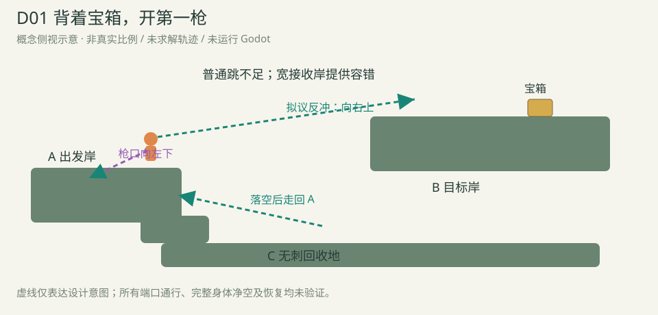
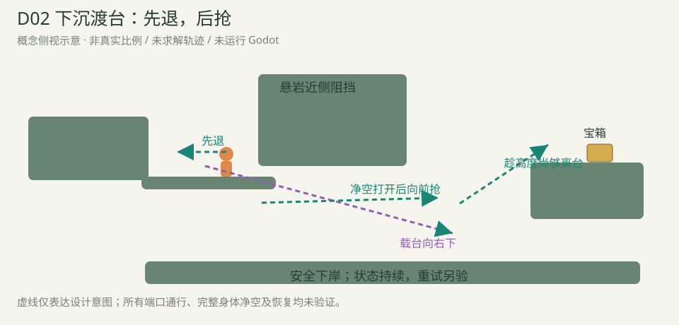
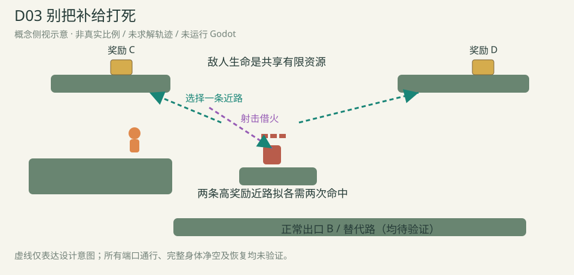
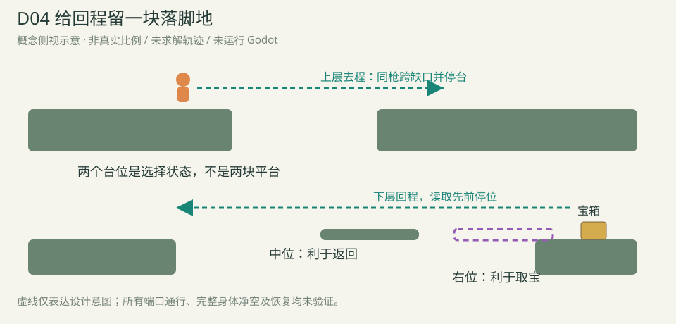
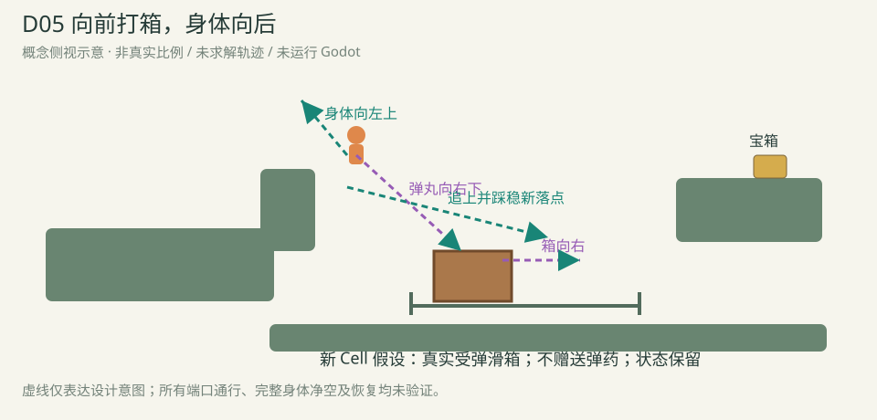

# 平原新 Module：五份创意设计 v1

本轮交付设计提案，不生成关卡、不运行物理、不进入可玩候选库。能力限定移动、普通单跳、射击反冲。下图是概念侧视示意，不是Godot截图或按真实比例求解的地貌。

三类成熟度分别标注：原Cell可复用但缺生成规则；还需补可读表现；需要新Cell。所有端口通行、动作容错和资源连续性均待验证。旧家族的教学化/用途深化不计成新玩法家族。

|编号|设计|玩家的核心判断|实现条件|
|---|---|---|---|
|D01|背着宝箱，开第一枪|从哪里起跳、朝哪个方向开枪，才能把普通跳跃差的一截补上？允许提前或稍晚射击，也允许多种斜射角。|复用原Cell，需新生成配方|
|D02|下沉渡台：先退，后抢|人在台上的前后位置怎样变化，才能既不被过早送进悬岩，又不把离台高度耗光？|复用原Cell，需新生成配方|
|D03|别把补给打死|把有限敌人生命花在哪条奖励近路？要不要现在冒险；若失败已经耗去一次命中机会，是否改走较难替代路线？|需HP可读表现与共享状态配方|
|D04|给回程留一块落脚地|现在把台留在中间方便回来，还是留在奖励侧，接受回程再调整/走另一条有动作成本的路线？|复用原Cell，需新生成配方|
|D05|向前打箱，身体向后|在哪里开枪、箱子会停在哪里，以及角色被推回后是否还有足够高度追上新落点？可以比较先布置再过、与一次飞行中处理两件事的策略。|需新增受弹滑箱Cell|

## D01 · 背着宝箱，开第一枪

**让玩家亲眼学会：准星朝向和身体要去的方向，可以相反。**

**职责：**安全教学

**玩家先看见：**入口就能看到右上方宝箱、宽接收岸和下方无刺回收地。岩上用弹痕和箭头提示向左下开枪；先给试错空间，不先放计时门或敌人。

**拟议游玩过程：**

1. 普通跳够不到目标岸，但会落到下方回收地。
2. 向左下射击，反冲将角色送向右上方宽岸；目标是理解方向，不是复现指定帧。
3. 真正落稳、触及宝箱后领取奖励；出口位于该岸。

**因果关系：**同一次射击消耗真实空中枪，并改变人物位移；本案不额外改变世界。

**地貌与端口意图：**A为宽出发岸，B为更高且略远的宽目标岸，C为低处回收口。A→B拟需反冲；A→C和C→A构成短重试。回收坡只通回A，不直接通B。

**奖励：**宝箱从A可见，位于宽岸内侧，成功落地后自然可取得，不把领奖本身变成第二道精确操作。

**失败恢复：**失败落到C，按原地面接触恢复跳跃/空中枪；沿短坡回A。设计目标是几秒内重试，具体时间待实测。

**去回程差异：**B回A拟利用高度差下降到C再回A，不要求把去程射击倒放。回程身体落点仍需独立验证。

**必须尝试的绕法/反证：**

- 延长普通跳跃即可直达B。
- 从回收坡绕上B。
- 相同进场条件下不需要判断反冲方向也总能到达，缺少方向反馈；合理换位、斜射仍应接受。
- 可操作区间过窄，教学变成背按键。

**可复用的Cell：**岩体/安全地面、原普通跳跃/反冲/冷却、原奖励事务

**当前缺口：**

- 安全教学配方尚未实现
- 宽容射向/开枪区间、完整身体净空和重试时间未实测

**相对已有内容：**原反冲跨越/高低分路的教学化改作，不计新玩法家族。 降低失败成本，让玩家用对照理解反冲，承担当前库缺少的首次教学职责。

**适配方向（只是需求候选，均未验证）：**

- 横向宽入口→右上宽出口，低处第三口用于恢复。
- 竖向入口→侧向出口：先向下反冲抬升，再落向宽侧岸；不自动视为同一参数微调已通过。

**落地时的关键证据：**普通跳/反向误射对照；真实24×36身体净空；扰动下稳定出口；落空→落地→沿坡重试的连续见证。

## D02 · 下沉渡台：先退，后抢

**地面在替你前进，但你必须先后退；等净空打开，又要趁高度还够时抢到前缘。**

**职责：**承载中的运动控制

**玩家先看见：**高岸停着一块宽载台，轨道斜向右下穿过悬岩；远岸宝箱与出口始终可见。玩家能看见“先降到岩底以下，随后离目标岸越来越低”的矛盾。

**拟议游玩过程：**

1. 登上载台，朝前方风铃开枪：台开始向右下，人物受到向后的反冲。
2. 先逆着台走，减缓人物向前的世界位移，等整个人降到悬岩近侧阻挡的下方。
3. 穿过悬岩后向台前缘移动，在仍有足够高度时跳离、利用反冲上远岸。

**因果关系：**开动载台的同一枪把玩家推向后侧；后续挑战来自角色相对载台的位置和持续下降的高度。平台上落地照常恢复空中枪，不虚构弹药锁。

**地貌与端口意图：**斜向下沉的宽台、有限长度悬岩、较高远岸和无刺下岸。原铃离港后由真实岩体挡住射线；远端另有同机关接收器。此处不依赖离台惯性长期叠加。 悬岩近侧在尚未下降时挡住过早前移；下降后这处阻挡解除，而载台继续降低会使远岸超出合法跳跃/反冲上升范围，形成前抢理由。靠后登台等实现相同判断的替代操作应接受。

**奖励：**宝箱位于远岸宽落点内侧，驱动玩家在高度耗尽前做出决定；不在窄台边缘要求二次精确领取。

**失败恢复：**落空进入下岸，真实落地恢复。可经短坡与沿途接收器重新进入原台流程，保留台的位置/运行状态；不强制站在码头等一整圈。能否做到短重试是验收点。

**去回程差异：**返程拟沿上方/侧向岩路下降汇回入口，不把反向乘台当已通过。

**必须尝试的绕法/反证：**

- 零轴坐到底即可成功。
- 岸上预停在最佳位置，再跳台直达。
- 普通跳从入口直达远岸。
- 离港后仍能随意射铃暂停，完全省略台内选位。
- 台下降过快，实际脱离承载而依靠脚本贴人。

**可复用的Cell：**原ModuleMovingPlatform斜向轨道/承载、原ShotLatch启动/暂停与接收器、岩体/反冲/奖励

**当前缺口：**

- 遮铃几何、台宽、合法下降速度及离台高度窗口未求解
- 真实承载和完整恢复路线未验证

**相对已有内容：**A2载台家族的运动控制深化，新独立家族资格待反例与体验审查。 原A2主要追上落点；这里主要在移动的地面上主动调节自己的世界位置，没有转乘或长时间等台。

**适配方向（只是需求候选，均未验证）：**

- 横向入口→较高远岸：以低悬岩形成先退后抢。
- 从高侧口进入斜台→下方侧口离开，增加一个中途安全撤离口；逐方向另验。

**落地时的关键证据：**承载期间相对位移/世界位移分别记录；多起始相位与输入扰动；省略反向走位/预停等反例；离台、落空和机关状态持续的恢复。

## D03 · 别把补给打死

**敌人能借给你一次空中续枪，但每借一次，也在消耗这个补给本身。**

**职责：**有限资源与探索取舍

**玩家先看见：**安全观察岸可看见一只原3HP敌人、两个高处可选奖励点，以及一直可走的普通出口。需用与真实生命联动的清晰表现告知敌人不是无限补给。

**拟议游玩过程：**

1. 在飞行中向敌人射击，实际伤害提交且人仍在空中时获得原规则的续枪机会。
2. 设计目标是任一高奖励近路都要两次有效敌人命中后续枪，实际次数由高度/空间和原伤害回充求解；原3HP不能支撑两条近路各取两次命中。到岸后按真实接触恢复玩家资源。
3. 敌人受伤与死亡持续保留。再次出发须根据剩余生命调整；敌人耗尽后拟保留正常出口和两奖励的较难替代路径，均尚未验证。

**因果关系：**一枪同时提供反冲、造成真实伤害并触发原命中回充；收益同时减少未来可借的命中机会。次数由真实HP/伤害决定，不另造“补给次数”。

**地貌与端口意图：**局部四端口：A观察/出发口、B正常出口、C/D可选高奖励口。敌人站在稳定实体岩台，不悬空、不假设它受击掉层；两个奖励口共享同一个真实敌人状态。

**奖励：**两个箱子的价值和入口都从观察岸可读。主出口不依赖敌人存活；敌人耗尽时奖励应仍有较难替代通路，避免一次误射永久丢失收益。

**失败恢复：**漏射/漏接落到下岸，落地恢复玩家动作，敌人不复活、不回血。必须让玩家在再次起跳前看见剩余资源与替代路线，避免隐蔽惩罚。

**去回程差异：**出去时把敌人当助推资源，回来时可能面对残血或已死的敌人；回程用已发现的实体支撑，不强求同一借火动作再来一次。

**必须尝试的绕法/反证：**

- 地面连射清敌后，两条奖励路仍轻松可达。
- 不命中敌人也能完成同样空中链。
- 所谓回充实际来自擦到岩台。
- 耗尽敌人后奖励或出口软锁。
- 三次受伤的成本玩家无法读懂，只感到重试受罚。
- 一次命中就能顺取两箱，两条近路实际上没有共享资源取舍。

**可复用的Cell：**原EnemyActor/HealthState与基础枪伤害、原ShotEnergyPolicy空中命中回充、原落地恢复/岩体/奖励

**当前缺口：**

- 真实HP余量的可读表现需补齐
- 共享敌人状态的多奖励路径、耗尽后的替代路未生成
- 杀伤/回充时序及失败后状态持续需连续验证

**相对已有内容：**air-refund家族的有限共享资源深化，不提前计为新家族。 原样品证明一次命中接两枪；这里检验多次探索/失败共享一份会耗尽的世界资源，选择和代价跨越单次跳跃。

**适配方向（只是需求候选，均未验证）：**

- 左右两个奖励侧口共享中间敌人，并保留独立正常出口。
- 一个高奖励口和一个捷径口共享敌人；资源用在收益或缩短返程上，不能默认镜像互通。

**落地时的关键证据：**每枪实际伤害、HP、回充与是否触地；同世界取宝/失败/再试而不重建；敌人死亡后的所有声明出口；首次观察能否理解有限性；敌人已死且两个奖励均未取、只取一箱等连续状态仍可取宝和离开。

## D04 · 给回程留一块落脚地

**去程的一枪不仅帮你越过眼前缺口，还在决定回来时桥留在哪里。**

**职责：**探索中的提前布置

**玩家先看见：**上层去程能俯瞰下方回程沟、空载平台，以及偏右奖励支台。两种停位的用途必须在出发前就能看懂：中间利于直接返回，右边利于取宝。

**拟议游玩过程：**

1. 在近岸启动平台，经过正常实体支撑恢复后继续上层去程。
2. 在越过上层缺口时朝左下接收器射击；同枪向右上的反冲帮助跨越，平台暂停在玩家选择的位置。
3. 回来时读取持续保留的停位：中位服务回程；奖励侧服务下探取宝，但需要重新调台或采取另一段反冲路线汇回。

**因果关系：**关键空中射击同时帮助角色前进并确定未来支撑位置。没有自动到端点停泊，也不增加平台改向能力；只用原启动/暂停。

**地貌与端口意图：**上层去程、下层回程、偏侧奖励支台构成局部三端口样品。原铃和返回侧接收器需有可读而不同的射线；平台状态不因离开视野复位。

**奖励：**奖励在A处可见，右停位明显更利于取得；中间停位不提供免费隔墙领奖。

**失败恢复：**停错不会封死出口：下层保留真实可走的恢复/替代段，允许回到可调台位置。替代段应有实质动作内容，不能用空走长廊惩罚。

**去回程差异：**去程主要从上层射击布置，回程主要利用或修正已经造成的世界状态；两段不重复同一次空中追台。

**必须尝试的绕法/反证：**

- 从高处直接拿箱并跨回，停位完全无价值。
- 不调台走替代路总是更快更安全。
- 回程任意位置都能补射，提前布置无需思考。
- 平台中位/奖励侧实际都服务同一路线。
- 一次停错就只能重建世界。

**可复用的Cell：**原载台启动/暂停、循环轨道、原同机关返回接收器、反冲/岩体/奖励

**当前缺口：**

- 两种停位确有不同通达价值的几何尚未生成
- 去回程同世界状态继承、返回接收器射线与替代成本未验证

**相对已有内容：**停台/回程组合的用途变体；与M20同平台两职责有亲缘，不宣称新家族。 M20关注眼前两种互斥用途；本案关注离开后仍惦记的世界布置，回来看见自己先前选择的结果。

**适配方向（只是需求候选，均未验证）：**

- 上层去程→下层反向回程，第三口接奖励支台。
- L形侧向进入→高侧离开，下方返程口服务已停的平台；端口关系逐一声明UNKNOWN。

**落地时的关键证据：**同场景去程→取宝→返回；两停位成本/收益比较；不调台/提前领奖反例；错停与回程重试。

## D05 · 向前打箱，身体向后

**你必须把落点往前送，但朝落点开枪又会把自己推离它。**

**职责：**新Cell：造落点与反冲同时发生

**玩家先看见：**短滑槽中的木箱、两端止挡和远岸宝箱同时可见；近侧岩唇挡住一部分安全地面射线。用箱上箭头说明受弹移动方向，不把普通装饰箱伪装机关。

**拟议游玩过程：**

1. 跳过遮枪岩唇，从上方朝右下方箱体射击。
2. 拟议新Cell让箱沿有限滑槽向右移动，同枪把人物推向左上。
3. 用普通空中移动落到已移动的箱上；真正踩稳后按原规则恢复空中枪，再跳向远岸。

**因果关系：**同次真实弹丸接触改变支撑位置，原反冲改变玩家运动，二者方向相反。命中箱体不应被误当敌人命中回充；这项资源接入本身需要新增Cell验证。

**地貌与端口意图：**有限横向滑槽、两端止挡、足够空中回旋空间与下方安全岸。木箱不会自由掉出世界；支撑/碰撞/停止必须由真实Godot身体处理，不能直接搬运玩家。

**奖励：**远岸箱子从入口可见，落到滑箱只是中间成果；最终仍须到远岸落稳领取。

**失败恢复：**失误落下岸，按真实落地恢复。保留木箱位置；可走到能再次瞄准的位置调整，不能自动把箱送回初始挡。

**去回程差异：**去程主要创造支撑位置；高岸返回可尝试落到现箱后下岸，不一定再次推动它。箱的错误停位也需有恢复方案。

**必须尝试的绕法/反证：**

- 普通跳跨过整段，无需木箱。
- 安全预推箱后全程普通跳可过。
- 预推总是无代价且显著更优，所谓空中处理无价值。
- 打箱意外回充，破坏一枪资源关系。
- 箱碰到止挡抖动或夹人，导致虚假落地/连发回充。

**可复用的Cell：**原弹丸、枪口与人物反冲、原岩体、落地资源、奖励、未实现：受弹滑箱Cell/有限滑槽/稳定真实承载

**当前缺口：**

- 尚无受弹滑箱Cell，不能冒称现有移动平台已实现
- 受弹事件、滑动/停止、承载/防夹与不回充接入均需验证
- 不使用无重力EnemyMotor充当物理箱，不用普通门/定速台悄悄替代
- 原on_projectile_hit先调用shot_energy.on_hit，再判断enemy_hit；仅把箱标为非敌人并不能保证不回充。必须明确独立受弹接入并验证。

**相对已有内容：**新增的物体-人物反向运动假设，能否成为独立新家族待实现与审查。 区别于移动射线窗，玩家要站上自己刚刚挪动的支撑；区别于射铃追台，落点变化直接来自这发弹丸对箱体的作用。

**适配方向（只是需求候选，均未验证）：**

- 横向短槽→较远同高奖励岸，重在相对位置。
- 同一水平滑槽→高侧出口，重在是否保留足够高度；不把箱扩写成任意斜轨能力。

**落地时的关键证据：**弹丸真实首接触与箱体响应；原枪弹药/冷却不被箱子返还；完整身体稳定承载及止挡防夹；预摆位等合法替代的实际成本比较。

## 本轮自查与建议

优先落地D01，补平原首次反冲教学；D02最适合检验现有Cell还能产生多深的运动判断；D05用于检验新Cell创意的价值与成本。D03适合在基础空中资源已经教过后使用，D04适合与B的具体回程需求一起深化。

独立模型审查修正了五类问题：不按射向词误杀合理替代；台上后退是减缓而非冻结世界位置；敌人耗尽后连未取得的奖励也须保留可达方案；停位选择必须有真实成本差异；非敌人标签本身不能保证受弹箱不触发原命中回充。此审查是模型设计审查，不是人工批准或物理通过。

[版本化设计数据](../../pcg/creative-production/plains-five-designs-v1.json) · [本次人工需求原文](../../pcg/feedback/workshop/idea-sources/human-plains-five-designs/v1.json)
