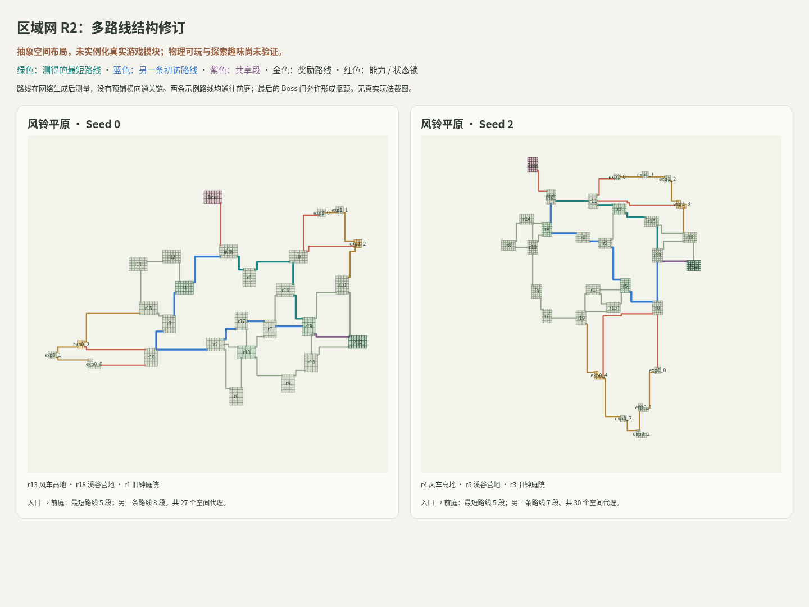
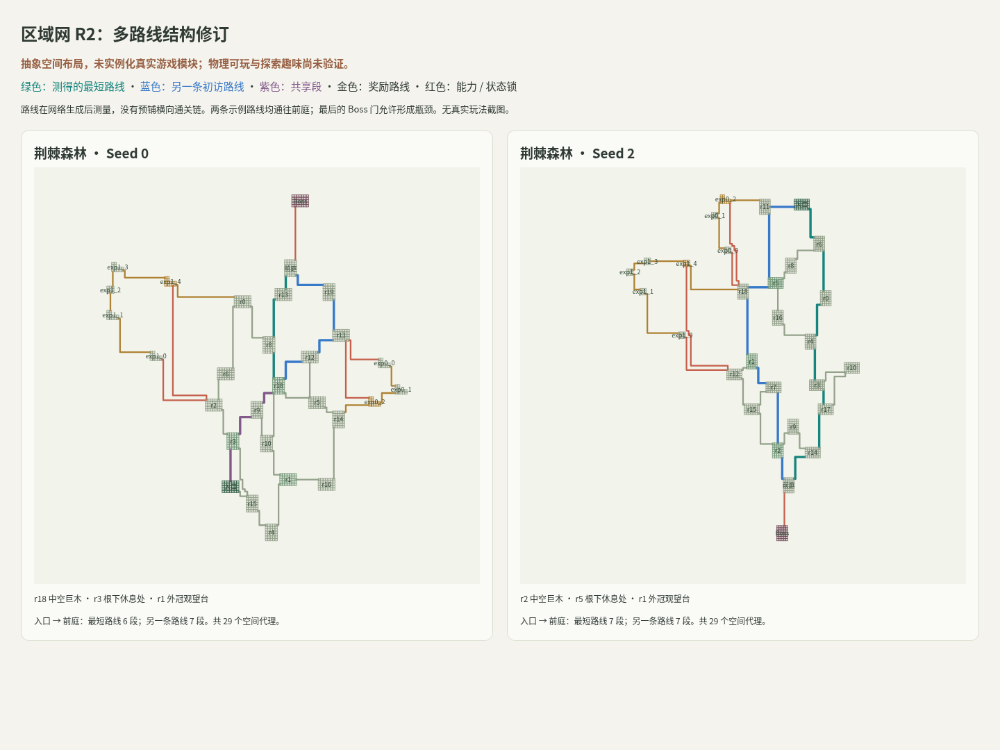

# 区域探索方向修订：淘汰固定横向主干

2026-10-24，承接玩家反馈：第一版新算法有横向直达通路；目标是《空洞骑士》单个区域的多路线探索感。本轮继续在 map-edit 隔离实验，没有替换正式游戏。

## 第一版的问题是真实的

首轮 A/B/C 共同的 `mapgen.py` 将 `m0…m5` 固定在 y=0，已有通路先保证入口直达 Boss。240 个样本的最短通关成本全部为 5。额外回环和支路改变外围，没有改变“中央快车道+旁边选做题”的基本体验。这不能满足本任务，亦不能因逻辑通过率高而认定质量好。

不采用“把直线弯折/旋转”修补：一条弯曲的必经链仍然是线性地图。旧批次保留为反例、组件实验及可复现证据，不晋升为最终地图方案。

## 现有游戏、首轮原型和本轮修订的比较

| 方面 | 现有游戏生成 | 首轮 A/B/C | 区域网 R2 方向原型 |
| --- | --- | --- | --- |
| 主体结构 | 平原三套手写足迹变体；森林 v15 围绕大树的手写空间配方，v18 增加接续场所 | 固定六节点横向主干，三组奖励支线，添加交叉连接 | 20 个核心场所组成可绕行区域网络，再绑定入口、前庭、地标及两段深入奖励路线 |
| 多路线 | 已有真实分支、汇合、单向落下及奖励开捷径；变化范围受配方约束 | 外围有分支和回环，但主干压过探索职责 | 核心不采用必经房间链；检查初访有两条差异明显的路线；奖励区从另一处接回 |
| 空间认知 | 森林大树和内外层关系已有实际内容基础，这是优点 | 抽象方块和走廊，几乎没有区域语义 | 分离的地标节点、上下路线与重逢点；仍只有语义标签，未证明玩家能辨认或看见 |
| 随机性 | 在既有骨架、场所次序、形态、奖励与敌人配置内变化 | 额外边不同，关键主干和职责固定 | 核心连接、入口/前庭位置、地标分布及奖励路线随 Seed 改变 |
| 验证优势 | 真正的角色、敌人、机关、模块和 Motor；已有部分完整真实操作证据 | 独立图、状态检查、抽象不规则占用/端口嵌入；算法组件可比较 | 复用状态/几何检查，另加方向反例：弯曲必经链、过早解锁捷径也被拒绝 |
| 当前不足 | 非通用任意图布局；新接缝、完整运动/资源/相位状态还需验证 | 内容是合成代理，设计结构也不合要求 | 依然是合成代理，尚无真实物理、战斗、发现感或人工趣味证据 |

两者都使用 Seed、固定内容池、分支和奖励；“旧版全线性、新版才有回环”是不准确的。旧版真实动作和区域空间比首轮方块图更成熟；新原型的优势目前在可拆分、可检验的生成基础设施。现阶段不能声称新算法比旧版更好玩，也不能用不同节点规模、不同成本单位的分数排名。

源码审计：[平原调用链与限制](current-state.md)、[森林内外路线、状态捷径与真实测试范围](forest-audit.md)。真实旧版截图绑定 `gunman-rush@cd4989a`，见 [整图截图](../../experiments/l4-mapgen/results/whole-maps-20261024/README.md)。这与下方的新结构示意严格区分。

## 《空洞骑士》一个区域的感觉，落实成哪些职责

1. **区域是地点网络。** 入口、休息点、地标、前庭之间有不同走法，允许中途换路和重新汇合。不是所有房间都必须有两条出口；Boss 门、局部咽喉、小秘密死路可以保留。
2. **主线简洁指完成成本较低。** 不预设横向直达线。自然的较快路线可以跨越高低层，穿过部分熟悉空间；深入奖励承担额外风险和连续动作挑战。
3. **回环改变行程。** 进入时绕远，完成探索后从另一边回到认识的地标，或开启节省回程的捷径。单纯多一条边不能证明循环有价值。
4. **空间会被重新理解。** 远处看见未达目标、隔墙听见熟悉场所、从高处落回旧路需要真实几何、镜头、视线和声音证据，不能由图上的“地标”标签代替。
5. **区域有不同组织方式。** 平原尝试台地、溪谷、风车高地与上层奖励路线；森林尝试树腹/外冠、根部/冠层、上升与下落回程。当前椭圆长宽和名字只是早期控制，不等于区域生态已实现。

目标是借鉴多路线、认知与回访的体验，不复制《空洞骑士》的房间结构；最终还要适配射击反冲、精力、钩索和肉鸽单局节奏。

## 实际运行的修订原型

新增独立入口 [`region_network.py`](../../experiments/l4-mapgen/region_network.py)，版本 `map-notes/region-network-v2`，不修改冻结的首轮组件。

当前构造：固定 20 个核心场所预算，采样位置→Delaunay 邻近图→保留双连通性的稀疏化→安排入口/前庭/三个分离地标→添加两段 3–5 场所奖励远征，包含异处汇合、单向下落和奖励后开放的回程。最终 Boss 门允许形成瓶颈。两条初访路线在生成后测量，不是先画出的主线。

这是针对探索方向的**网络构造实验**，不是已完成的 Mission–Space Grammar。它目前先形成核心网络再绑定任务；长期实现仍应由区域任务/空间职责指导语法扩展，与可用 Macro 接口双向约束。双连通是本轮用来反驳必经链的控制条件，不能机械施加给所有未来区域。两条路线的边重合上限、垂直跨度等也只是方向约束，不是趣味评分。

| 本轮数据 | 平原 | 森林 |
| --- | --- | --- |
| Seed | 0–19 | 0–19 |
| 图级状态验证 | 20/20 | 20/20 |
| 抽象占用/连接几何验证 | 20/20 | 20/20 |
| 区域方向约束 | 20/20 | 20/20 |
| 空间代理数 | 27–30 | 27–31 |
| Python 生成耗时 p50 / p95 / 最大 | 64 / 188 / 205 ms | 72 / 474 / 2412 ms |
| 真实角色物理、人工趣味 | 未验证 | 未验证 |

共 40 份结果有 40 个不同的无标签 WL 指纹；这是结构差异证据，非体验多样性证书。耗时为当前容器单次观测，含图验证和有界嵌入，不含真实内容实例化，非目标设备 Runtime 基准。森林最慢约 2.4 秒，必须保留失败与重试成本，不能仅凭中位数承诺实时生成。

本轮能力门只使用区域入口已授予的能力，尚未实现区域内拾取新能力后的任务顺序生成。发现隐藏路线、奖励开捷径和前庭开 Boss 门是抽象永久状态；真实门的操作方式、有限资源、动作相位、隐藏条件和奖励风险收益均待接入。未测 R2 峰值内存。





图中绿/蓝为测得的两条初访路线，紫色是共享部分，非预铺主线。真实走廊格来自求解结果，不是为好看补画的连接；房间形状和连接仍是假定可通行的代理，没有实际射击反冲或钩索动作证明。

完整结构与失败字段：[`runs.json`](../../experiments/l4-mapgen/results/region-network-v2/runs.json)、[汇总及源码 hash](../../experiments/l4-mapgen/results/region-network-v2/summary.json)、[实际 Chromium 回执](../../experiments/l4-mapgen/results/region-network-v2/browser-receipt.json)。

另在新目录完整重跑 40 份：排除计时后的摘要全部与交付批次一致，并逐份重新执行状态、区域方向和几何检查，见 [复现回执](../../experiments/l4-mapgen/results/region-network-v2/reproduction-receipt.json)。Map Notes 原检查、28 项组件/内容/方向测试、冻结首轮 240 份证据核验和查看器语法检查通过。

复现：

```sh
python3 experiments/l4-mapgen/region_network.py --seeds 20 --output /tmp/region-network-v2-rerun
npm run check:mapgen
python3 -m http.server 8080
# http://localhost:8080/experiments/l4-mapgen/viewer.html?dataset=region-network-v2
# 可选 Playwright + Chromium：
python3 experiments/l4-mapgen/capture_region_network.py
```

下一轮先固定同一批真实多出口 Macro，提供占用、端口和 `entry_state → exit_state` 运动/资源传递关系，再把这些职责嵌入真实空间，检验最短完成路线、替代路线、奖励探索与回程。需要比较同内容/能力/规模条件下的地图与人工试玩结果，才能判断新方案是否真正优于现有森林。现有两端口资源不足以直接承载所有核心枢纽；不能为了接入而把区域网重新串成横向链。

后续问题的实际检查：[现有 Module 的异尺寸拼装与 R2 端口容量](real-module-composition.md)。全部 72 份 Resource 放宽假设后也仅 36/40 通过必要端口数量条件；这不是空间布局或物理通过记录。
