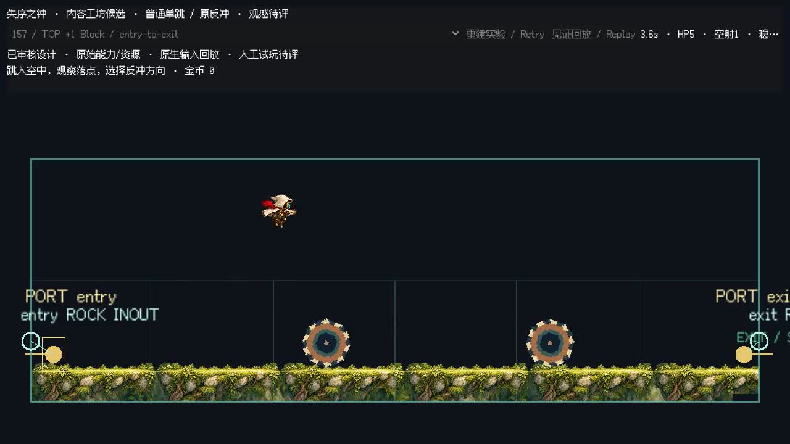

# 157 顶部增加 1 Block：当前技术通过

用户本轮要求“157上高度+1block”。按这项明确调整，把原 6×1 矩形的顶部从 y=204 扩至 y=76，成为 **6×2（768×256）**；地面 y=300、两只齿轮的坐标/半径/轨迹/周期、两侧 Port 和内部站位全部保持不变。世界对象逐项相等，侧口重新归属下排 Block；没有补墙、加台或改变原物理。齿轮正上方的完整身体中心余量由 4px 增至 132px。

新版本独立保存，绑定[用户授权及几何差量](authorization/request.json)、[实际目标快照](authorization/target-design.json)、[逐项结果](157.json)。发布过的设计 JSON 和设计网页不改；旧 6×1 版本的未合格记录及全部失败继续保留，本次不追认旧版。

- 预先限定 6 个控制方案，每方案 3 clean + 3 mild + 3 moderate，共 54 次全部通过；按预登记顺序选择首个。另一次冻结前预筛 13/13 通过。
- 正式校准与独立留出各为 clean/mild/moderate **12/12、12/12、12/12**。加上边界和有限反例共 **91 次**，整体通过；深度复核重新读取原始输入、输出、SHA、动作和原门槛。
- 实际可玩包加载和原生输入回放通过。影片为官方 Godot 4.7.2、60 Hz、1 倍、无剪切、1 秒尾停留；实际 HP=5、安全落稳。
- 影片严格逐帧比较仍为 **FAIL / review-only**。本片的差异仅有支撑节点 ID 及附加的空 `paired_gates` / `retractable_groups` 状态字段；原比较器的位姿、速度、输入和资源字段没有差异。完整严格失败保留，不把它改称 exact。

可玩入口：[demo.tscn](../../../../pcg/manual_review/implementation/157-upper-block-final-v1/game-plains-twin-gears/playable/demo.tscn)。用官方 Godot 4.7.2 打开 `pcg/prototype/godot/project.godot` 后运行该场景，支持原生回放及手动操作。

当前已实施的 46 项，在各自已声明路线/初态范围内均为技术 PASS；没有其它当前物理失败。最新 main `f11b7756` 的 161/162/163/165 是新增审批、尚待实施，172 是新增废弃、尚待删除，均不属于本轮 157 调整范围，也不冒称技术失败。镜像、封口组合、未声明方向、完整 Map、真人试玩与生产批准仍为 UNKNOWN。

新原始证据归档为 `pcg/archives/approved-157-upper-block-v1`：4 个运行目录、3,263 个逻辑文件、1 分片，9,643,600 字节；整包 SHA `cf53fe102d1980d91d864c02eb2232872599da16af1f87751a52db7862b99a9d`，分片、整包和每条目已核验。870 个原游戏保护文件 SHA 不变；`npm run check` 通过。

```sh
python3 pcg/tools/restore_archive.py approved-157-upper-block-v1 --verify-parts-only
python3 pcg/tools/restore_archive.py approved-157-upper-block-v1 --extract
python3 -m pcg.manual_review.index_157_upper_block_v1
```

索引只读复核已有证据，不启动新的校准或留出。历史 Harness 的绝对 extends 需要 `/workspace/map-edit-task-a` 指向本仓库；技术通过不等于人评/生产批准。



授权目标快照保留原设计的历史描述文字；当前尺寸由该快照的 `bounds` 和本轮授权差量明确为 6×2，旧 `summary` 中的 6×1 不代表本轮目标。实际样品与正式输入均使用新矩形。
