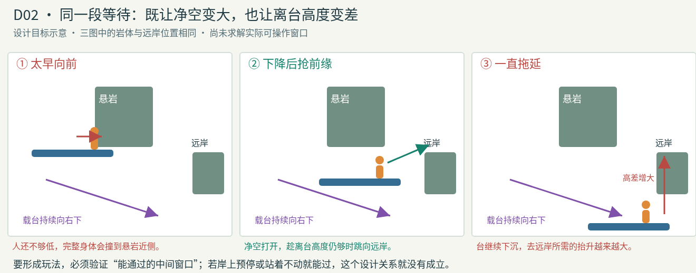
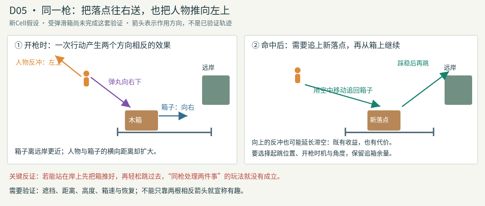

# D02 / D05 的操作取舍示意

[原五案设计](../../../docs/l4-mapgen/plains-five-designs-v1.md)。本轮用分阶段侧视图解释两种假设，不按世界单位绘制，不表示轨迹已求解或Module已通过。

- D02：等待下降有助于完整身体避开悬岩，也会降低离台高度。需实际存在可操作窗口，并解决已发现的岸上预停等绕法。
- D05：同枪把箱往右送，把人物推向左上。上升可延长滞空，横向分离增加追箱成本；两效果相反本身不足以证明玩法。仍需实现受弹滑箱、验证预推箱替代及真实承载。

同名SVG保留可编辑矢量原件；PNG由浏览器渲染该SVG，仅作设计说明。
