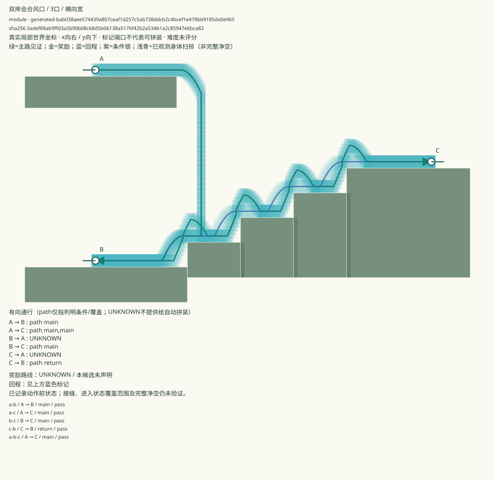
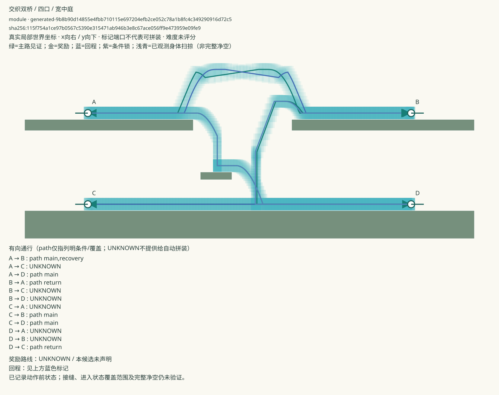

# 可玩多端口路口 · 首轮

> 当前状态：用户已否决J06/J03，认为无聊且缺设计感。四份版本保留为技术试件，已从平原优选暂扣；下文是历史技术交付记录，不代表体验认可。[原话与版本绑定](../../../pcg/feedback/workshop/junction-boring-observation-v1.json)。

4份新候选、2种空间语法，各响应两种空间需求。原库94→98，平原候选82→86。全部使用真实Godot角色与原Cell；没有新增Map Generator。技术通过后进入候选库，人工趣味、实际试玩与生产认可尚未完成。

[完整清单与版本](manifest.json) · [实现报告与限制](../../../docs/l4-mapgen/junction-modules-v1.md) · [独立模型设计审查](../../../pcg/creative-production/curation/junction-implementation-review-v1.md) · [生产/失败/复用回执](../../../pcg/creative-production/junction-implementation-cycle-v1.json)

|编号|实际空间与选择|已验有向关系|
|---|---|---|
|J06-1|横向宽风口：高处来岸落入共同首阶，选择西下通路或东升阶地|A→B、A→C、B→C、C→B；另有连续A→B→C|
|J06-2|紧凑高差风口：阶距缩短、高差增大，相同分流职责|同上，分别实测|
|J03-1|宽中庭双桥：上层跨桥/下降，下层直行/反冲换层|A→B、A→D、C→D、C→B、B→A、D→C；另有连续A→D→B|
|J03-2|较窄、较高、偏心中庭双桥|同上，分别实测|

去掉宝箱后，这些节点依然有不同的继续开口。内部悬台和落脚地不额外算端口。所有路线共享同一份地貌与初始世界；连续路线不重建角色或恢复资源。外部地图仍须把这些开口接向实际通路。

## 短视频

全部正常1倍速度、原生60Hz输入回放；六片共2267帧与各自原物理见证逐字段匹配，末尾另保留1秒完成定格。可以直接按编号反馈，无需填表。以下是程序回放，不是人类试玩录像。

- [J06-1：先走西岸，再返回登阶到东岸，8.53秒](https://raw.githubusercontent.com/zhipijun1996/map-edit/content/task-a-workshop/generation/workshop/junctions-v1/videos/J06-1-a-b-c/windgap-junction.mp4)
- [J06-1：同一落点直接选择东岸，5.98秒](https://raw.githubusercontent.com/zhipijun1996/map-edit/content/task-a-workshop/generation/workshop/junctions-v1/videos/J06-1-a-c/windgap-junction.mp4)
- [J06-2：紧凑高差接口的连续路线，8.17秒](https://raw.githubusercontent.com/zhipijun1996/map-edit/content/task-a-workshop/generation/workshop/junctions-v1/videos/J06-2-a-b-c/windgap-junction.mp4)
- [J03-1：先下降至D，再反冲升回B](https://raw.githubusercontent.com/zhipijun1996/map-edit/content/task-a-workshop/generation/workshop/junctions-v1/videos/J03-1-descend-then-lift/woven-bridge-interchange.mp4)
- [J03-1：选择上层直接跨桥](https://raw.githubusercontent.com/zhipijun1996/map-edit/content/task-a-workshop/generation/workshop/junctions-v1/videos/J03-1-upper-east/woven-bridge-interchange.mp4)
- [J03-2：偏心高庭的下降、返回与升层，8.18秒](https://raw.githubusercontent.com/zhipijun1996/map-edit/content/task-a-workshop/generation/workshop/junctions-v1/videos/J03-2-descend-then-lift/woven-bridge-interchange.mp4)





另见 [J06-2图](modules/J06-2.svg)、[J03-2图](modules/J03-2.svg)。图中的关系连线不等于穿越实体的移动轨迹，实际走法以对应回放与原始物理帧为准。

## 网页查看与原生试玩

打开[关卡编辑器](https://zhipijun1996.github.io/map-edit/)，点击「更新仓库 Module」，选择反冲平原并搜索「双岸会合风口」或「交织双桥」。更新源是内容分支，首屏静态索引可能仍为之前的94份。 [公网实测回执](evidence/publication.json)已核对：更新后98份、平原86份，两种新节点各2份，打开编辑副本正常；六段影片和四份原库文档均已从公网逐字节核对。

从仓库根执行。先按`pcg/WORKSPACE.md`安装原Godot4.7.2并恢复runtime；完整原件还原命令：

```sh
python3 pcg/tools/restore_archive.py godot-runtime-v1 --extract
python3 pcg/tools/restore_archive.py content-workshop-junctions-v1 --extract --prefix results/
python3 -m pcg.prototype.creative_batches.plains50_catalog --manifest generation/workshop/junctions-v1/manifest.json --list
python3 -m pcg.prototype.creative_batches.plains50_catalog --manifest generation/workshop/junctions-v1/manifest.json --play J03-1 --route lower-to-upper
```

默认手动控制，也可加`--replay`查看精确路线。三口可选`a-b`、`a-c`、`b-c`、`c-b`、`a-b-c`；四口路线见清单。手玩不同方向不会自动为UNKNOWN生成验证证据。

## 给B的输入、输出与接缝

标准Module文档：[J06-1](modules/J06-1.mapnote.json)、[J06-2](modules/J06-2.mapnote.json)、[J03-1](modules/J03-1.mapnote.json)、[J03-2](modules/J03-2.mapnote.json)。仍为`gunman-rush-level-sketch/v1 + generationContract`。全部36个有序对显式列出：20个有条件path、16个UNKNOWN、0个no_path，未把有限反向失败冒称已证单向。

[首次J06交接清单](handoff-j06-v1.json)是在另外家族完成前输出的两份候选接口；不声称B已消费或完成整图联调。

从原持久化库查询精确Challenge Specification：

```sh
python3 -m pcg.prototype.creative_batches.junctions.query_v1 --examples
python3 -m pcg.prototype.creative_batches.junctions.query_v1 --spec demand.json
```

不满足时返回`unsatisfied`、具体字段冲突、比较过的接口及可协商项；不会将UNKNOWN返回成path。已在全新进程逐一完成4次精确复用和24次矛盾需求拒绝，0新物理调用，见[evidence/retrieval.json](evidence/retrieval.json)。需求是本轮明确的模型设计接口，不冒称实际B整图输入或盲需求泛化。

[两份接缝试件回执](evidence/seams.json)共102/102真实案例通过：把原入口支撑拆成两块等union矩形，完整24×36身体双向跨缝后继续到原另一端口；0新增实体、0传送/资源授予/腿间重建。这是精确碰撞分割连续性试件，未升级原Module的通用接缝、任意进入速度或摆放变换。复现：

```sh
python3 -m pcg.prototype.creative_batches.junction_windgap.seam_fixtures_v1 --manifest generation/workshop/junctions-v1/candidate-manifest-v1.json --name fresh-junction-seams
```

空间、外接碰撞、进入动量、未验方向和整图由B继续验证；不得在接缝补地形或恢复资源。当前地貌是有辨识度的初版构图，未宣称美术完成或人工认可。
