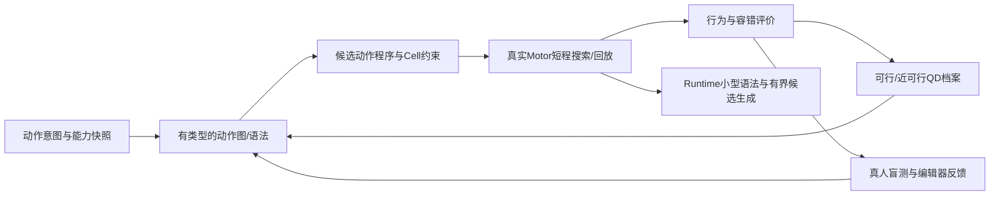

# 《失序之钟》程序化动作关卡研究与可执行原型

研究日期：2026-10-23 UTC。任务 `PCG-RESEARCH-01`。结论依据分为论文事实、冻结代码审计、实际物理试验和设计推断。**本次交付是可复现的研究原型，不是已经实现“稳定、有趣、Runtime 大量自动创造”的生产系统。**

## 1. 结论与选择

**现在先投入方案 A 的动作驱动核心；长期候选是有条件的 C。暂不把 CP-SAT、FI-MAP-Elites 或 WFC 当作质量来源本身。**

已经证明的能力：只给矩形承载 Cell、静态危险包络、真实钩点和角色机制，先采样真实输入轨迹，再生成接收平台与绕障几何；无需读取完整预制 Module。最终有五个不同几何场景、六个试玩条目通过同源真实 Motor 输入回放，包括连续三次反冲和钩索/奖励分支。最后角色均落地、速度为零，奖励路实际先到奖励位置再汇合。

尚未证明的目标：开放式创造新动作语法、难度精准可控、足够的人类容错、趣味/重玩价值、手机操作，以及在线预算。本次词汇仍只有少量人工规定的动作骨架；数百个不同几何不等于数百种玩法。误差成功率和行为覆盖暴露了这一差距。

本次受限同域对照中，A 的请求有效产出为 **165/192**，B 与 C 均 **130/192**；C 与 B 产生同样的物理候选，CP 未增加几何创造能力，只增加成本。这个结果支持“先做好动作表示和评价”，不能推广成所有 QD/CP 方法不如 A。只有一个优化 run，没有跨 run 显著性或真人结论。

- [论文与九类算法的完整研究](research/algorithms.md)
- [七仓库 README、代码、许可与维护审计](research/repositories.md)
- [游戏/编辑器当前架构审计及永久代码链接](research/architecture.md)
- [最终独立技术审查](research/review-final.md)
- [原型适配与验证边界](prototype/godot/ADAPTATION.md)

## 2. 审计发现：现有系统究竟会生成什么

冻结游戏正式 main：`e9ab0e0743466b8983e34cc7de17bab1abf9d53a`；最新开发集成：`integration/four-lines-20261023@12f6cb006d7119598e3235f4ca4f7323e4c9d092`。后者是本次发现的当天集成分支，不声称所有专题分支都已合入。Map Notes：`ccbb21eec9f4d92e46ab9a95d35abb664dc69189`，其模块库来源仍是旧游戏 `74d8a06b...`。

- **平原**：正式调用 `PlainsRegionGenerator`，从三个人工拓扑族生成变体，再使用17个人工动作配方与资源模块池装配；它有版本、种子、能力筛选、奖励/捷径/回退，但没有在线从动作目标解出全新局部几何。
- **森林**：普通入口默认 `forest-bible-world-v15`；V16–V18存在不代表成为默认。V15是在既定布局上安装人工坐标、动作步骤与分支的版本化工厂。
- **Foundry**：六模板、12模块序列和有限相位/短语/itinerary组合。真实输入、完整身体扫掠和回放是可复用资产；按 module_id 分派的专用 driver 是主要限制。它不是任意地形动作规划器。
- **Harness/Skills**：前者编排检查、输入、预算和证据；后者规定创作/审查流程。均不等于玩法生成算法。新增更多规范无法替代实际动作表示、求解器与失败反馈。
- **数据层级**：平台/危险 Definition 可作为 Cell；Module 有 Resource 与森林字典两套表达；Macro 多为配方/路线，尚无统一跨段状态可达集合；Map 是地区专属 Manifest。`macro_chain.tres` 的名字不代表独立 Macro 类型。
- **真实能力**：集成版基础是一跳一发；钩索是拉近/悬挂/弹起状态机，不是绳摆。Foundry 的 hook 登记仍标未实现，与真实 Traversal 已实现不一致。
- **编辑器**：177份参考=72资源+51森林工厂+36工坊短语+18路线。现为游戏→草图单向转换；路线时间条无真实物理。`npm run check`实际通过不等于关卡通过。

应保留 Motor/Router/能力资源/碰撞、Seed与Manifest身份、装配/保存、真实回放及原Harness；应重新设计候选IR、动作前后条件、状态区间/相位兼容、通用前向搜索、违反约束反馈和行为档案。无需先推翻全部现有消费者。

## 3. 论文核实与适用层级

| 方法 | 借鉴重点 | 本游戏层级 | 不能直接获得的保证 |
|---|---|---|---|
| Tanagra | 动作/Beat先行、层次模式、几何约束、改动后重规划 | Module，部分Macro | 原系统仍依赖模式库和简化物理，不保证复杂反冲/钩索的鲁棒通关 |
| Compton/Mateas 2006 | 重复、节奏、非线性结构分层 | 四层架构映射 | 原四层是 Components→Patterns→Cells→Cell Structures；不能把论文Cell当本项目最底层Cell |
| Action/Graph Grammar | 先描述行为关系、分叉/共处/关联，再布局 | Module→Macro→Map | 2013案例为地牢；新语法推导不等于自动发明新机制 |
| MAP-Elites | 行为分箱保留质量与覆盖 | 离线Module/Macro | 不自带趣味函数，也不保证档案维度反映玩家体验 |
| FI-MAP-Elites | 可行/近可行档案不同选择压力 | 离线Module搜索 | 原任务是房间拓扑几何；需替换为本游戏物理违反度与动作描述符 |
| CP-SAT | 整数坐标、互斥、端口、能力锁、分叉/奖励约束 | Cell布局、Macro/Map | UNKNOWN不是无解；不独立模拟连续物理；Godot/Web原生集成有成本 |
| A*/Forward planning | 位置+速度+资源+动作状态+相位搜索 | Module可达/容错 | 状态爆炸、启发与离散化会漏解；当前游戏没有通用可克隆完整物理状态 |
| MCMCTS | 对构造/语法下一步分配rollout预算 | 小Module或离线 | MC是Markov Chain；原论文低精度A*忽略敌人，不是Godot真实物理rollout成绩 |
| WFC/CSP | 锁定可玩空间后局部邻接与覆材 | Cell/美术 | 局部一致不证明动作意义或全图可达；原实现有限limit成功还须检查完整观察 |

原始论文、作者、年份、DOI及参考代码位置见[完整论文报告](research/algorithms.md)。本原型没有复制 Mario/FI 受限源码：前者README限制研究非商业，后者缺根LICENSE。pyribs MIT、OR-Tools Apache-2.0、Godot CSP和WFC代码MIT；样本图/第三方美术另查。procgen-lab是Godot .NET工程，含未分发素材，且MST步骤会丢回环，不能整包照搬。

## 4. A/B/C协作方式与本次实际实现

建议的目标流水线：

- **A目标**：有前后条件的动作语法→运动包络/几何约束→有预算的动作规划→真物理重播。当前原型实现“动作采样→真轨迹→接收面/危险净空反推→重播”，没有完整ABL/Choco或通用A*。
- **B目标**：在动作树、空间关系和Cell参数上变异，用物理违反向量改进失败者；多行为策略和鲁棒性提供质量。当前B是独立实现的简化双档案，只变异宽度/净空，近失败只用进度，质量主要偏向短见证。因此它不是原FI论文完整复现，也不代表纯无结构地形进化。
- **C目标**：A产生语义合法的候选，离线QD学习有价值的规则/参数域；CP解决真正的多物体/端口/分支约束。当前C只给B增加一个落点整数居中问题；B直接居中即可得到相同解，所以测不到CP增益是合理结果。

所有策略共享真实采样动作库、基础Cell与重播接口。本次对照只比较受限候选策略，**不是三套完整算法体系的严格性能排名**。没有测试MCTS/WFC性能，也没有把调研项目自己的成绩当本游戏实验数据。

主要代码：`prototype/trajectory_synth.py`（动作词、轨迹反推、共享约束、拼链与描述符），`experiment.py`（候选预算/双档案/CP调用），`evaluate_deliverables.py`（噪声、删动作、拼接、奖励重汇合），`prototype/godot/runner.gd`（真实输入物理批处理），`main.gd`（同源手动试玩/回放）。

## 5. 实验条件、样本与公平性修订

真实 Godot **4.7.2 Standard**，二进制与官方ZIP SHA已校验；系统预装4.6.3未用作结果。物理60Hz、完整身体24×36；复制开发集成原始Motor/Controller/Router/Jump/Shoot/Traversal/资源字节，逐文件[来源清单](prototype/godot/source_provenance.json)。原型只换调试外观和去除纯视听反馈，不修改运动参数。AMD EPYC 9V74环境，CPU可见5，Python3.12.14、OR-Tools9.15.6755；[环境记录](results/environment.json)。

初始出生后4帧落地；此后没有角色传送、强行补弹/精力或手动恢复。连续反冲由真实落地恢复；钩索用真实 `grant("grapple")` 和 `GrappleAnchor`。当前射击本身不耗时间能量，本实验所有见证能量保持100，不能声称已经验证精力压力/命中回能或动态机关。

危险是静态矩形包络，以真实完整身体逐帧保守扫掠拒绝接触；平台使用真实StaticBody2D、钩点真实Area2D。**没有实例化正式荆棘伤害、敌人/奖励交易、死亡回退、存档或动态机关相位。** 这里的物理成功只证明声明的静态危险无接触且真实角色到达。

- 校准1000–1011：保留V1失败与V2修复。检查全轨迹占据后改善，但校准A/B/C物理输入相同，不能当作算法比较。
- 请求种子724030–724061，32个动作程序/挑战种类；每种策略每类96次请求（3代×32）。从真实采样不能构造接收面、或共享约束拒绝也计入请求分母。
- `holdout-v1` 独审发现CP独有24wu余量导致不公平。**保留原件，统一A/B/C相同宽度/边界域后重跑为 `holdout-v2`。** V2是方法修订同种子重跑，不是第二个独立holdout。
- V2总计64个运动采样+518个几何候选=582次真实物理case；有效425个标签候选。3代共享32个程序，标签/回放不是独立玩法样本。

## 6. 实际测量

主表以修订后V2为准。每格预算96请求；第二列物理重播率另报，避免丢掉早期拒绝美化成功率。

| 挑战 | 受限策略 | 有效/请求 | 有效/已重播 | 行为档案覆盖 | 每有效候选摊销耗时 |
|---|---|---:|---:|---:|---:|
| 反冲 | A_action | 87/96（90.6%） | 87/96（90.6%） | 6/20 | 29.6 ms |
| 反冲 | B_fi_qd | 70/96（72.9%） | 70/95（73.7%） | 6/20 | 35.5 ms |
| 反冲 | C_hybrid | 70/96（72.9%） | 70/95（73.7%） | 6/20 | 42.6 ms |
| 钩索 | A_action | 78/96（81.2%） | 78/84（92.9%） | 1/20 | 39.7 ms |
| 钩索 | B_fi_qd | 60/96（62.5%） | 60/74（81.1%） | 1/20 | 44.8 ms |
| 钩索 | C_hybrid | 60/96（62.5%） | 60/74（81.1%） | 1/20 | 52.1 ms |

耗时包含各策略参数生成与分批新Godot进程开销，运动采样共同成本另记；不是单个新进程冷启动延迟，更不是手机/Web Runtime帧预算。该次总墙钟约18.4秒，Python峰值约133MiB，子进程最大RSS约157MiB；不能简单把两个峰值相加称同时内存。逐批真实命令、退出码、CPU与峰值在 `*.execution.json`。

**B与C的全部物理输入/结果相同，C只多出求解成本。** 本次不能证明CP在新动作几何上有增益。A更高产出也不等于更好玩：B/C被短时长代理质量驱向较窄候选，评价与搜索表示先要改。几何规范化哈希重复率只是去平移后16wu量化，不含镜像/缩放同构；不将其低重复解释为玩法低重复。

### 误差与动作依赖

误差测试24个策略标签其实只有**8个不同物理模块**（每类4个）；三组共享首代候选，噪声随机数不同。报告合并为每种4模块、每模块30个扰动，不按算法排名，避免把相同几何随机波动称算法收益。

| 挑战 | ±1帧、±2° | ±3帧、±6° |
|---|---:|---:|
| 反冲 | 62/120（51.7%） | 34/120（28.3%） |
| 钩索 | 89/120（74.2%） | 50/120（41.7%） |

这是对固定见证的离散时机/瞄准扰动，不模拟所有人类操作。小样本、同模块多次回放相互依赖，没有据此计算玩家成功率或独立样本显著性。`robustness-table.json`保留原分组，`pooled-robustness.json`给合并口径。

删掉固定程序中的反冲后反冲12/12失败；钩索样本删钩索12/12失败、删射击12/12失败。轴清零也全失败，但这只证明该见证需要移动，不能单独证明“必须空中换向”。三条连续反冲的真实vx正→负各发生3次，确实执行了反向修正。

删动作未重新寻找所有替代策略，**不能据此证明该能力不可替代或没有廉价绕行**。尚缺通用前向规划器的替代解搜索，这是下一阶段质量门槛。

### 多样性与难度：本次的重要负结果

行为描述符从接受的射击方向和真实腾空占时计算，不按地形标签计数。但反冲只覆盖6/20格、钩索1/20格；接受事件骨架主要是 `jump→shot` 和 `jump→hook→jump→shot`。三条长链都是已有成功动作词的三段组合，不是三种新语法。

目前仅有“新参数几何”和少量动作关系组合的创造证据，**没有足够的新玩法类型覆盖**。难度1–10没有经真人校准；窄落点/低容错不自动等于设计精妙。单靠扩大档案和生成量无法解决此问题。

## 7. 三项挑战的实际交付

| 实验 | 实物 | 已验证 | 边界 |
|---|---|---|---|
| 1 连续反冲绕障 | 三个不同几何的连续Module | 每个3跳/3发、3次反向修正、完整连续输入、真实落地恢复、末态站稳 | 原子词组合，未证明开放式创造新动作；尚缺真人可读性/容错 |
| 2 钩索狭窄空间 | 一张带承载障碍和危险包络的钩索挑战 | 真抓取1次、2次跳跃、1发、无危险扫掠接触 | 单钩点，尚非复杂连续多钩空间；正式荆棘伤害与美术未接入 |
| 3 多路线重汇合 | 同一几何的低风险主路/上方技巧奖励路 | 主路0跳0发0钩；奖励路1钩1发3跳，落地访问奖励区域后到共同出口 | 主路仅安全通行；奖励为位置访问，未实现正式领取交易；不宣称完整探索段落 |

六个试玩条目、五个几何场景。最终6/6真物理成功，末态均落地且v=(0,0)、余弹1，角色在出口集合内。交付源自V1首代成功候选，统一约束V2的首代仍相同；[最终重播](results/deliverables-v2/delivery-replay.output.json)、[摘要](results/deliverables-v2/summary.json)。

[20.7秒真实Godot录像](delivery/modules.mp4)包含1242帧、60fps，展示六个实际输入见证，无before（算法首次产出）。录制模式是离线渲染，约27秒墙钟不是Runtime性能；逐帧位置与headless参考最大误差0.0，[比对原件](delivery/recording-comparison.json)。图示为静态轨迹叠加，不能当录像：[反冲样例](delivery/figures/continuous-recoil-0.png)、[钩索样例](delivery/figures/module-grapple-724030-C_hybrid-g0-j0.png)、[分路样例](delivery/figures/multiroute-0-reward.png)。

Web是原生Godot导出，非另写JavaScript物理。调试美术和交互用于研究；初次全资源包约196MiB；保留原件后改用场景依赖导出，最小场景导出因缺动态依赖失败，补齐真实依赖后的最终包约102.9MiB（PCK64.9MiB、WASM约37.7MiB），重新执行21条真实浏览器检查与六次回放全部通过。缩小的是已验证候选的导出闭包，**不证明Runtime在线生成或手机性能已达标**。浏览器实测见 `delivery/lean-export-report.json`、`delivery/lean-verification/browser-final.json`，发布身份见 `delivery/PUBLICATION.json`（以实际存在和状态为准）。

## 8. 下一阶段可执行技术路线

先把成功标准从“能重播”升级为“值得玩”，再扩Macro/Map：

1. **动作IR与真正的组合搜索。** 原语只定义真实动作的前后条件，变异的是依赖/恢复/共同作用关系和时序偏序，不保存整段布局。加入同一发子弹触机关并反冲、钩点恢复后再反冲、观察/等待/补救、带速度的交接。保留不在训练骨架中的接受事件图作为候选新体验；新图还需人工确认意义。
2. **通用前向模型/规划器。** 先有限动作集和短时域，从真实状态搜索而非module_id脚本。快照至少含普通/反冲速度、跳跃/余弹/冷却/精力、Traversal目标与阶段、动态物件相位、敌人状态和epoch。不能只改motor.position当成状态恢复。先用可隔离场景重演前缀作正确基线，再优化完整快照/并行worker。
3. **可行度向量和稳健性质量。** 记录身体/危险余量、目标距离、落点速度、资源缺口、钩索遮挡与失败帧；预算未找到路径单列unknown。Q取目标难度附近的容错、恢复空间和可读性代理，不奖励单纯最短/最窄；用真人结果校准。
4. **QD只在动作树层有收益后扩大。** 先2–3维小档案；使用真实抓取/反冲贡献、空中换向、最长无恢复动作链、重试恢复和玩家策略分歧。加入几何同构/事件n-gram/轨迹簇去重，采未优化seed和不同水平控制器。pyribs用ask/tell调度，FI双档案和违反度由项目实现；不要盲加高维格子。
5. **CP解决真正的多物体关系。** 离线CP-SAT做平台/危险互斥、视野与接缝、能力和奖励拓扑，查表运动包络只作保守剪枝；最终回真实物理。当前一个landing-left变量没有必要作为Runtime依赖。
6. **扩大至Macro/Map。** 先验证一个Module的入口状态集/出口状态集，再组合相交状态与资源恢复。Map用有向能力图、多路线回环和空间嵌入；不能照搬MST删掉奖励回环。WFC仅在可玩空腔、危险表面和port halo锁定之后覆材。

不预先承诺固定毫秒或质量门槛已达成。正式晋级前应有多次独立搜索run、预注册同域/同物理预算、替代解搜索、动态相位/低资源/不同入口速度、手机和Web p95时间/内存、原正式消费者回归及真人评估。

### 离线与Runtime职责

| 离线 | Runtime |
|---|---|
| 批量真实轨迹采样、FI-QD与语法变异、替代解/消融、容错测试、失败分类、真人校准 | 根据本局能力/武器与种子采样轻量动作图，有限参数域求解，快速保守剪枝 |
| 输出小型规则/可行域、版本化运动表、行为描述符与少量已验证保底 | 有预算地验证候选、记录Manifest与物理版本，失败/超时回退；不让玩家等待大型进化 |
| 验证区间保守性、跨版本失效和玩法覆盖 | 保存入口出口/资源/相位，不从离线一个成功点推断整个连续参数区间 |

本次尚无Runtime在线生成器接入Web；试玩站加载的是本次实际生成并验证的候选。生成过程可由Python+Godot命令复现，不把预生成展示冒称浏览器实时创造。

## 9. Map Notes接入：已做什么、下一步做什么

已实现 `prototype/mapnotes_export.py`，把六条真实候选导出为现有 `gunman-rush-level-sketch/v1` 工程，保留准确世界坐标逆平移、稳定ID、真实见证路线、输入程序与验证范围。已用当前编辑器 `validateDocument()` 实际逐份验证六个JSON。`difficulty.score=null`；最低能力条件未求解，保持unspecified，并把见证使用能力放研究证据字段，避免伪造能力锁。

这是一条**候选→人工评审草图**的真实适配，不是编辑器回写游戏已完成。后续：

- 编辑器保存ChallengeSpec：动作意图/偏序、Cell参数域、entry/exit状态、风险与奖励、能力完整性、禁止关系；既有草图schema不冒充运行IR。
- 转换服务生成 CandidateModule：世界几何、真实输入witness、失败帧/容错曲线、核心源码/引擎/能力hash、随机流和收据。固定单向映射，曲线轨道/无消费者对象报unsupported，禁止静默降级。
- 页面并列显示“预期路线”和“真实轨迹”；任何几何/物理/能力/机关变化使旧验证失效；通过Godot试玩链接提交人工可读性/公平性/技巧感/重复感，不自动签趣味。
- 修改原模块采用baseCommit三方差异和补丁；正式资源/森林工厂分别适配。先不放宽旧Foundry.valid身份守卫，而新增版本化generated_candidate消费者。

## 10. 人类试玩评估与完成边界

目前**没有招募真人、没有人工趣味评分、没有手机真机数据**。不能把自动轨迹、AI看图或高通过率替代这些结果。已准备[人工盲测表](research/human-playtest.md)，建议比较固定基准与匿名生成候选、记录实际能力/设备/顺序；每人多seed，先不揭示生成方法，评价可读性、公平性、技巧表达、新鲜感和再次游玩意愿。

完成情况：论文/七仓库审计、当前架构差距、A/B/C技术分析、动作驱动可执行原型、真实生成与静态危险物理数据、录像/可玩导出、离线Runtime划分、Map Notes导出与后续方案已提供。复杂多钩连续空间、动态机关/战斗/精力联合、通用替代解规划、Runtime现场生成、人工趣味/设备及正式集成仍未完成。

**最终研究判断：减少大型人工Module库是可行的工程方向；本次已经打通“动作→真实轨迹→新几何→连续重播”，但还没有证明“新几何→大量有设计感且值得重玩的挑战”。下一笔投入应放在动作图表示、通用反例搜索、稳健性与真人评价，而非继续堆模板、规则或生成数量。**
